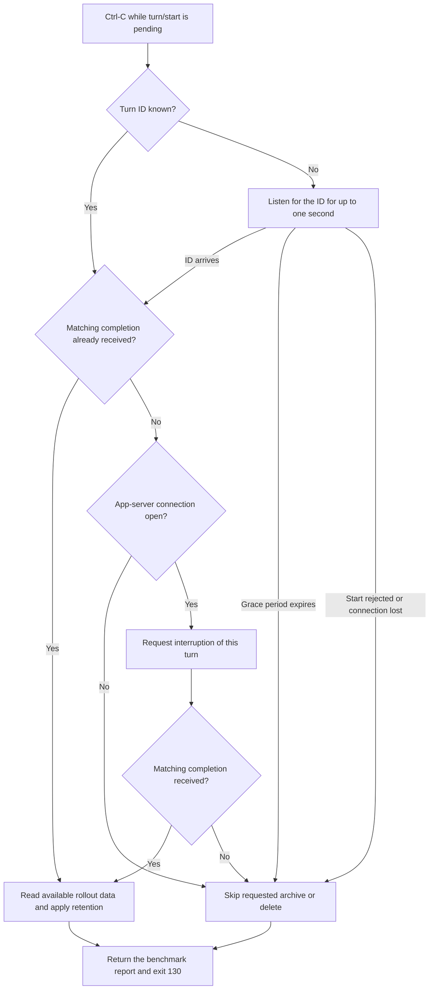

## Goal

Compare Codex's recorded first-token timing, output token rate, and full turn time for a fixed workload. `cdx-chores codex-bench` runs fresh, prompt-only turns through the configured provider and reads the saved records for those trials. The report shows one terminal row per model and requested speed.

The speed selector also applies to commands that already accept Codex execution overrides, including the explicit `interactive` startup command. An in-menu benchmark picker is a later design.

## First Live Check

Run the [live check script](../../scripts/spikes/codex-benchmark-live-check.ts) manually from the repository root. It uses the repo's Codex binary and the active Codex home and provider. Pass a model ID and reasoning effort explicitly. Omitting `--speed` runs one Standard/Fast pair for that model. Set `--speed standard`, `--speed fast`, or `--speed ultrafast` to run a single trial.

```sh
bun scripts/spikes/codex-benchmark-live-check.ts --model gpt-6-luna --effort medium
bun scripts/spikes/codex-benchmark-live-check.ts --model gpt-6.2-sol --effort medium --speed ultrafast
```

On 2026-11-18, Codex CLI 0.170.0 completed all three requests through the configured `openai` provider with `medium` reasoning effort and the LRU prompt below. Each trial used a fresh persisted thread and produced a single assistant message with no reported tool activity or reroute.

| Model | Requested speed | Sent tier | Saved first token (ms) | Saved duration (ms) | Saved output tokens | Turn output tok/s | Terminal record on first read |
| --- | --- | --- | ---: | ---: | ---: | ---: | --- |
| `gpt-6-luna` | Standard | `default` | 3,379 | 9,741 | 354 | 36.34 | Yes (2 ms) |
| `gpt-6-luna` | Fast | `priority` | 2,698 | 6,843 | 344 | 50.27 | Yes (1 ms) |
| `gpt-6.2-sol` | Ultrafast | `ultrafast` | 4,044 | 5,804 | 361 | 62.20 | Yes (2 ms) |

Every `thread/start` response supplied a rollout path. The first read found the matching `task_complete` while app-server was still running. The last column measures elapsed time from receipt of `turn/completed` through reading and parsing that record. Saved duration and output tokens matched the live values for every trial. The live check predated session retention.

The completed turns establish request acceptance for these selections. Served speed remains unknown. Each row is a single observation, and the Ultrafast trial uses a different model.

## Key Findings

- `codex-info models` reports advertised service tiers from Codex's picker-visible catalog. Catalog entries guide selection. Trial outcomes establish request compatibility for the tested provider and account. [^catalog]
- The shared Codex thread factory uses the SDK's `config` option for provider and speed overrides. Codex documents `fast` as mapping to the request value `priority`. [^execution] [^sdk] [^config]
- TypeScript protocol bindings generated with Codex 0.170.0 using `codex app-server generate-ts --out <scratch-dir>` confirm `TurnStartParams.serviceTierForTurn`, `Thread.path`, and the identifiers on text delta and turn completion notifications. The path is nullable. The first live check retrieved each run's saved records using the path returned at thread start. [^app-server]
- The Codex 0.170.0 rollout policy persists turn boundaries and token usage snapshots. Saved `task_complete` records can include `duration_ms` and `time_to_first_token_ms`. The latter is Codex's internal turn-start-to-first-token timing, which can be triggered by reasoning events before visible text. Ordinary turns can emit the terminal notification before flushing their saved completion record. [^history] [^rollout-write]
- Codex 0.170.0 returns the configured thread `serviceTier` from `thread/start`. Its completion notifications expose turn status, and the experimental `rawResponse/completed` event exposes counters and generic usage metadata. The inspected protocol has no documented per-trial served-tier field. The direct OpenAI Responses API reports the effective tier in its response object. [^app-server] [^api-fast]

## Settled Decisions

### Shared Speed Selection

`--codex-speed <standard|fast|ultrafast>` follows the command-local placement of `--codex-model` and `--codex-reasoning-effort`. Existing Codex entry points that adopt the shared selectors accept one speed per invocation. Omission delegates to the Codex configuration loaded for the request. An explicit value applies to the invocation, including its retries. For `interactive --codex-speed fast`, the selection belongs to the session and follows its helper requests, repairs, and regeneration. [^execution]

Use `standard` as the public spelling for the explicit Standard selection. The app-server turn override uses `default` for Standard. Fast and Ultrafast depend on model, provider, and account or workspace support. Reasoning effort is an independent setting. [^app-server] [^speed]

### Benchmark Workload and Selection

- Repeated `--codex-model` and `--codex-speed` values build a model × speed matrix. Every selected speed applies to every selected model, regardless of flag order.
- Handle unavailable speeds per model and speed combination. Report the affected combination as unavailable and continue the supported combinations at their requested speeds.
- In matrix mode, an omitted model supplies one inherited model selection and an omitted speed supplies one inherited speed selection per model. Omitted provider and reasoning effort inherit from Codex across the benchmark workload. Mark inherited selections in the report and include resolved values when Codex exposes them. Other Codex helpers default their omitted reasoning effort to `low`. [^execution]
- The built-in text prompt is the default. `--prompt-file <path>` reads a UTF-8 file once and uses its contents for every request. Validate missing, unreadable, invalid UTF-8, or empty files before inference. A task that needs input data can include a representative excerpt and output instructions in the prompt file.
- `--runs <count>` accepts one positive integer per invocation and defaults to `3`. Schedule that many measured trials and one warm-up for each matrix combination. Reject invalid values and repeated `--runs` flags before inference.
- In each measured matrix round, run every combination sequentially and rotate the starting speed (Standard/Fast, then Fast/Standard). Each request uses a fresh thread with `ephemeral: false` and the same prompt. Retain per-trial cache counts to help interpret order and prompt-cache effects. [^app-server] [^latency]

Use repeatable `--case MODEL=SPEED` to select individual pairs when each model needs its own speed. The selector splits at the last `=` and accepts `standard`, `fast`, `ultrafast`, or `inherit` for a nonempty model. For example, `--case "model=a=inherit"` selects `model=a` and delegates speed to Codex. The CLI rejects combining `--case` with `--codex-model` or `--codex-speed`. [Explicit-pair verification](../plans/jobs/2026-11-18-codex-cli-benchmark.md#explicit-modelspeed-pairs)

Each `--case` occurrence schedules one warm-up and `--runs` measured trials. Each round follows input order, including warm-up. Repeating a pair schedules another set of trials and adds its counts to the same model–speed summary.

The built-in prompt is shared across the workload.

> Explain how an LRU cache works to a junior developer. Cover a cache hit, a cache miss, and an eviction. Walk through a short example with a capacity of three. Write about 250 words and answer directly without using tools.

Use models and tiers available to the configured provider and account. The current matrix and inherited-selection commands support these forms.

```sh
cdx-chores codex-bench

cdx-chores codex-bench \
  --codex-model gpt-6.2-astra \
  --codex-reasoning-effort low \
  --codex-speed standard --codex-speed fast

cdx-chores codex-bench \
  --codex-model model-a --codex-model model-b \
  --prompt-file ./benchmarks/extract-invoice-fields.md --runs 5 \
  --show-prompt --show-token-usage --json
```

This two-model, two-speed comparison schedules twelve measured trials and four warm-ups across four combinations. A combination with two completed trials shows `2/3` in the Completed column.

```sh
cdx-chores codex-bench \
  --codex-model model-a --codex-model model-b \
  --codex-speed standard --codex-speed fast \
  --runs 3
```

Either command below schedules two warm-ups and two measured trials for the supplied pairs.

```sh
cdx-chores codex-bench --case gpt-6-luna=fast --case gpt-6.2-sol=ultrafast --runs 1 --compact
cdx-chores codex-bench --case gpt-6-luna=fast --case gpt-6.2-sol=ultrafast --runs 1 --json
```

### Saved Trial Records

Local rollouts are written under the running Codex home, normally `~/.codex/sessions/`. A custom `CODEX_HOME` changes that location. Use the resolved `codexHome` from the app-server initialization response as context. Read the exact `thread.path` returned by the app-server that ran the trial. If the path is unavailable in the start response, refresh it with `thread/read` for that thread ID. [^app-server] [^rollout-location]

Record both thread and turn IDs. On `turn/completed`, read complete JSONL lines immediately while app-server is running, including for failed and interrupted turns. Match the saved `task_started` and the terminal record by turn ID. A `task_complete` closes an ordinary turn and may contain an error. A `turn_aborted` closes an interrupted turn. Retry an unavailable path or missing matching terminal record within a bounded deadline. At expiry, keep the live outcome and mark metrics that lack saved evidence unavailable. [^app-server] [^history] [^rollout-write]

### Cancellation While Waiting for a Turn ID

The CLI sends `turn/start` once when a trial reaches inference. Ctrl-C can arrive after the local app-server starts the turn but before the CLI learns its ID from the reply or a `turn/started` notification. The CLI already knows the thread ID, but `turn/interrupt` requires both IDs. Exiting immediately would give up the chance to interrupt a turn whose ID is on its way. Waiting for the ordinary RPC deadline previously delayed exit by 15 seconds when the server withheld the ID.

The CLI waits up to one second from Ctrl-C for a usable turn ID. If the start request fails first, the wait ends immediately. Once the CLI has the ID, it checks for a matching `turn/completed` notification it may already have received. That notification confirms the outcome even if the start reply arrived later. The one-second limit is a responsiveness choice. The fixtures verify both a late ID and an expired wait. The distribution of ID arrival times in real runs remains unmeasured. [Cancellation verification](../plans/jobs/2026-11-18-codex-cli-benchmark.md#pending-turn-ids-initialization-failures-and-tier-rejections)



### Session Retention

Share the command-local `--session-retention archive|keep|delete` option across Codex helpers as they adopt a common session lifecycle. The live-check script and `codex-bench` use the same contract. The default, `keep`, leaves sessions in active history without a cleanup call. Explicit `archive` moves the session out of active history and retains its recoverable rollout. Explicit `delete` permanently removes the session and any spawned descendant threads through Codex app-server. [^thread-retention]

Apply retention only to threads the invocation created, including warm-ups, after Codex confirms the turn ended and rollout readback succeeds or reaches its deadline. Keep collected metrics and partial usage in the report. Skip cleanup for a trial without confirmed completion and report its thread ID when known. A retention failure preserves the trial result and reports the affected thread and error separately.

If a requested archive or delete fails after successful inference, `codex-bench` exits with status `1` and still emits the complete report, including valid JSON when requested. Keep the trial marked `completed` and report the retention failure and thread ID separately.

For SDK helpers, capture each newly owned thread ID when the SDK assigns it. A one-shot helper releases its thread after the SDK execution has settled and the result or error has been captured. A multi-turn helper releases its thread after its last dependent turn, including retries, repairs, or regeneration. An interactive workflow releases a reusable thread when it finishes with it. Apply the selected policy once per released thread and skip cleanup when the thread's completion or ownership is uncertain. Preserve helper results and report cleanup failures or skips separately with the known thread ID. [^sdk-thread]

The TypeScript SDK 0.170.0 exposes thread IDs and turn execution. Archive and delete use the app-server protocol, so the versions below refer to the Codex CLI binary. [^sdk-thread]

| App-server RPC | Codex CLI support | Live verified |
| --- | --- | --- |
| `thread/archive` | Documented by 0.61.0 | 0.170.0 |
| `thread/delete` | Introduced in 0.140.0 | 0.170.0 |

Use 0.170.0 as the verified integration baseline for both operations. For an executable override, verify support on the selected binary and use the same resolved executable and Codex home as the helper that created the thread. Report an unavailable RPC as a retention failure and preserve the helper result. [^thread-retention-versions]

Synthetic rollout checks showed that reading the records before cleanup preserves captured metrics when the session is archived or deleted. [Rollout recovery and retention evidence](../plans/jobs/2026-11-18-codex-cli-benchmark.md#phase-1-offline-rollout-recovery)

A separate live check ran one `gpt-6-luna` Standard trial at `medium` effort for each explicit retention mode. The archived rollout appeared in archived storage, the kept rollout stayed active, and the deleted rollout was absent from both locations. All three reported saved durations and output counts that matched the live values.

### Metrics and Reporting

A comparable sample comes from a completed turn with a single assistant text message. Require `phase: final_answer` when the protocol supplies that field. Exclude turns with tool activity, multiple assistant text messages, or a reported model reroute from the requested model's summaries. Report those trials and any available usage.

A completed turn with only a commentary message counts as completed and contributes any available token usage. It contributes zero usable samples for each performance metric.

| Metric | Definition |
| --- | --- |
| Codex first token | Recorded `time_to_first_token_ms`. Display seconds in the terminal and preserve milliseconds in JSON. |
| Turn output tok/s | Reported output tokens attributable to the turn, including reasoning output, divided by its recorded duration in seconds. |
| Turn time | Recorded `duration_ms` from the turn completion record. Display seconds in the terminal and preserve milliseconds in JSON. |
| Token usage | Saved input and output token counts, with cached input and reasoning output as breakdowns. Include cache-write counts when available. [^usage] |

Each fresh thread starts with zero usage. Within the verified turn boundaries, count the latest valid cumulative `total_token_usage` snapshot once. `last_token_usage` can cover just one model response. If the matching terminal record is still missing at the deadline, use the latest complete snapshot from the trial's own rollout after its matching `task_started`, provided that turn was still unambiguously active at the snapshot. A later turn start ends that attribution window. Without an attributable snapshot, report usage as unavailable. [^history]

Include attributable usage from failed, interrupted, or incompletely recorded turns in invocation totals and mark the totals partial. Exclude failed and interrupted turns from speed summaries.

Count usable measured samples for each metric separately from the completed-trial count. Turn output tok/s requires complete reported output usage and a positive recorded turn duration. An absent timing field, missing saved record, or unattributable usage leaves the affected metric unavailable. Show `—` for a terminal summary metric with zero usable samples. Report speed rejections as unavailable and other failures with their own status.

The detailed terminal view formats each cell from that metric's usable sample count, including when a run completes with only some metrics available.

| Usable samples | Terminal view | Example Codex first token |
| ---: | --- | --- |
| 0 | Unavailable | `—` |
| 1 | Single value | `0.82 s` |
| 2 | Minimum–maximum | `0.71–1.13 s` |
| 3 or more | Minimum / median (p50) / maximum | `0.71 / 0.82 / 1.13 s` |

Group benchmark results by model and requested speed. The **Requested speed** column shows Standard, Fast, Ultrafast, or Inherited. A single note below the table identifies that served speed is unknown in this app-server integration. JSON records `servedSpeed: null` for each trial. Configured thread speed, when shown, is configuration context. A completed trial demonstrates request acceptance by the configured provider. A future integration can populate served speed when it has documented telemetry tied to the trial. [^app-server] [^api-fast]

Both terminal views show inherited settings using metadata from completed measured trials in each row. `Inherited (configured Fast)` identifies the reported thread tier, and `Inherited (Low)` identifies the reported reasoning effort. `Inherited` alone means no value was reported. A label such as `Inherited (Low, partial)` means some trials report Low and the others report no value. `Inherited (Mixed)` means the reported values differ. [Inherited settings verification](../plans/jobs/2026-11-18-codex-cli-benchmark.md#phase-61-inherited-speed-and-reasoning-effort)

The report identifies the prompt source and each explicit or inherited Codex selection. Turn output tok/s is the default terminal throughput column. The illustrative rows below use the default of three measured trials. Show the metric's sample count when it differs from the number of completed trials.

| Model | Requested speed | Reasoning effort | Completed | Codex first token (s) | Turn output tok/s | Turn time (s) |
| --- | --- | --- | ---: | ---: | ---: | ---: |
| `gpt-6.2-astra` | Standard | Inherited (Low) | 3/3 | 0.71 / 0.82 / 1.13 | 57 / 63 / 69 | 3.74 / 4.10 / 4.65 |
| `gpt-6.2-astra` | Fast | Inherited (Low) | 3/3 | 0.68 / 0.80 / 1.08 | 78–96 (2 samples) | 2.91 / 3.20 / 3.65 |

*Served speed is unknown. Codex can record the first token during reasoning, before text appears. Turn output tok/s includes reasoning tokens and uses the full turn duration.*

`--compact` shows one median per available metric, the completed count, and the usable sample count when it differs. With `--show-token-usage`, it adds one line with warm-up, measured, and invocation totals.

`--json` takes precedence when both output flags are supplied. It writes one unstyled object to stdout with run context, per-trial results, and summaries for `codexFirstTokenMs`, `turnOutputTokensPerSecond`, and `turnDurationMs`. JSON uses `null` for unavailable metric values and includes each metric's sample count. `--show-prompt` includes the prompt below the terminal table or in `prompt.text` in JSON. The terminal view escapes control characters in the prompt and JSON preserves its content. [^output]

Requested settings describe the CLI selections. Matrix runs report `run.requested.models` and `run.requested.speeds`, with a `null` speed entry for inheritance. Paired runs report the ordered `model` and `requestedSpeed` values in `run.requested.cases`, also using `null` for inherited speed. Omitted reasoning effort is `null` in `run.requested.reasoningEffort`. For inherited settings, each trial already reports `configuredTier` and `resolvedReasoningEffort` when Codex provides them. A `null` in either trial field means the reported value was unavailable.

With `--show-token-usage`, detailed terminal output shows per-request and cumulative token totals on stderr, then a usage table with warm-up and measured subtotals and the invocation total on stdout. JSON puts detailed per-trial counts and invocation totals in the report. Invocation totals include reported warm-up usage and carry a partial label or flag when usage is incomplete. Turn output tok/s uses reported output counts independently of this flag.

### Progress While Running

Human output prints the planned workload on stderr at startup. Both human and JSON modes show one live status line when stderr is a terminal. The full line includes the request's position in the workload, model, requested or inherited speed, warm-up or measured trial number, status, and elapsed time. The first nonempty live text chunk changes the status from Waiting for text to Streaming. The example shows startup and two successive states of the same request in human mode.

```text
4 combinations · 12 measured trials + 4 warm-ups

[10/16] gpt-6.2-astra · Fast requested · Trial 2/3 · Waiting for text · 0.8 s elapsed
[10/16] gpt-6.2-astra · Fast requested · Trial 2/3 · Streaming · 2.4 s elapsed
```

Fit the live line to the current width of stderr's terminal. Prioritize request position, status, and elapsed time. Add the model, requested or inherited speed, and trial number as space allows. Use shared display-width helpers before applying color, and reserve the final terminal column to avoid wrapping. These are examples of the same streaming state at narrower widths. [^progress-layout]

```text
[10/16] gpt-6.2-astra · Streaming · 2.4 s
[10/16] Streaming · 2.4 s
```

Redraw on terminal resize even during a pause in streaming. Clear any rows created when the previous line reflows after a shrink. Remove the resize listener when live progress ends. [^progress-layout]

Use a local monotonic clock for elapsed time and throttle redraws. Clear the live status before the report or final diagnostics on completion, failure, or cancellation. Redirected stderr carries the startup line, any opt-in per-request usage from the detailed human view, and diagnostics. In JSON mode, routine stderr output is limited to the temporary TTY status. Diagnostic labels follow the shared color rules, including `--no-color` and `NO_COLOR`. [^output]

## Verification Findings

The loopback checks confirmed the outbound tier mapping on both the SDK and app-server paths. The observed requests used `priority` for Fast, omitted `service_tier` for Standard, and used `ultrafast` for the advertised Ultrafast tier. The live check establishes provider acceptance for the tested requests. [Request wiring evidence](../plans/jobs/2026-11-18-codex-cli-benchmark.md#phase-2-offline-speed-request-wiring) · [Live acceptance evidence](#first-live-check)

The rollout fixtures established that a completion event can arrive before its saved record is readable. Bounded retries recovered delayed writes and paths. At expiry, the live outcome and attributable usage remained available for the report. [Offline rollout recovery evidence](../plans/jobs/2026-11-18-codex-cli-benchmark.md#phase-1-offline-rollout-recovery)

App-server turn notifications let the benchmark display live progress and handle cancellation. The progress display uses stderr, while measurement reads saved records and the final report uses stdout. Fixtures checked terminal redraws, cleanup, and parseable JSON. [^transport] [JSON progress and diagnostics evidence](../plans/jobs/2026-11-18-codex-cli-benchmark.md#json-progress-and-diagnostics)

The final CLI verification exercised the documented examples against a loopback provider and checked terminal shrink and widening while a fixture turn was streaming. The [benchmark guide](../guides/codex-benchmark.md) documents the shipped behavior. [Final verification](../plans/jobs/2026-11-18-codex-cli-benchmark.md#phase-7-documentation-and-validation)

## Related Plans

- [Codex CLI benchmark implementation](../plans/plan-2026-11-18-codex-cli-benchmark.md) tracks implementation scope, sequencing, and acceptance checks.
- [Codex execution configuration](../plans/plan-2026-09-05-codex-execution-configuration.md) records the existing command scope and session settings.

## References

[^catalog]: [Current catalog guide](../guides/codex-execution-configuration.md#inspect-configuration-and-catalog-metadata), [report mapping](../../src/cli/codex-info/report.ts), and [Codex model catalog protocol](https://learn.chatgpt.com/docs/app-server#list-models-modellist).

[^execution]: [Current Codex execution configuration](../guides/codex-execution-configuration.md).

[^sdk]: [Shared Codex thread factory](../../src/adapters/codex/shared.ts) and [SDK version lock](../../bun.lock).

[^sdk-thread]: [TypeScript SDK thread implementation at 0.170.0](https://github.com/openai/codex/blob/rust-v0.170.0/sdk/typescript/src/thread.ts).

[^config]: [Codex configuration reference](https://learn.chatgpt.com/docs/config-file/config-reference).

[^app-server]: [Codex app-server turn start](https://learn.chatgpt.com/docs/app-server#start-a-turn), [thread read](https://learn.chatgpt.com/docs/app-server#read-a-thread), and [streamed item deltas](https://learn.chatgpt.com/docs/app-server#item-deltas).

[^thread-retention]: [Codex app-server archive and unarchive](https://learn.chatgpt.com/docs/app-server#archive-and-unarchive-a-thread) and [thread deletion](https://learn.chatgpt.com/docs/app-server#delete-a-thread).

[^thread-retention-versions]: [App-server archive documentation at 0.61.0](https://github.com/openai/codex/blob/rust-v0.61.0/codex-rs/app-server/README.md#example-archive-a-thread) and [Codex 0.140.0 release notes](https://github.com/openai/codex/releases/tag/rust-v0.140.0).

[^api-fast]: [OpenAI API Fast mode configuration and tier reporting](https://developers.openai.com/api/docs/guides/fast-mode#configuring-fast-mode).

[^speed]: [Codex Fast and Ultrafast modes](https://learn.chatgpt.com/docs/agent-configuration/speed).

[^latency]: [OpenAI latency optimization guide](https://developers.openai.com/api/docs/guides/latency-optimization).

[^usage]: [OpenAI reasoning token usage](https://developers.openai.com/api/docs/guides/reasoning#understanding-reasoning-tokens).

[^history]: [Codex 0.170.0 rollout persistence policy](https://github.com/openai/codex/blob/rust-v0.170.0/codex-rs/rollout/src/policy.rs), [turn and token usage protocol definitions](https://github.com/openai/codex/blob/rust-v0.170.0/codex-rs/protocol/src/protocol.rs), and [first-token timing implementation](https://github.com/openai/codex/blob/rust-v0.170.0/codex-rs/core/src/turn_timing.rs).

[^rollout-location]: [Codex home environment settings](../guides/environment-variables.md) and [Codex 0.170.0 local rollout writer](https://github.com/openai/codex/blob/rust-v0.170.0/codex-rs/rollout/src/recorder.rs).

[^rollout-write]: [Codex 0.170.0 turn finalization and rollout flush](https://github.com/openai/codex/blob/rust-v0.170.0/codex-rs/core/src/tasks/mod.rs).

[^output]: [CLI output and color](../guides/cli-output-and-color.md).

[^progress-layout]: [Video frames progress renderer](../../src/cli/actions/video-frames-progress.ts) and [terminal display-width helpers](../../src/cli/text-display-width.ts).

[^transport]: [Codex executable resolution](../../src/adapters/codex/discovery/executable.ts) and [Codex discovery transport](../../src/adapters/codex/discovery/transport.ts).
