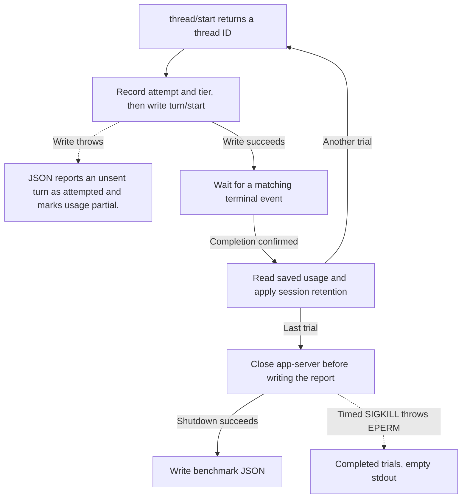
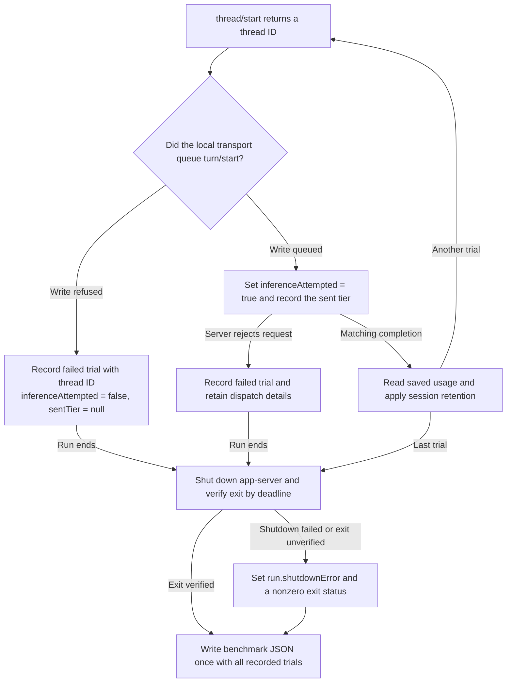

## Research question

If a Codex request fails or its process stops, what can `cdx-chores` still report about the turn and its saved session? The maintainer’s latest `bun run test:all` passed on `v0.2.2-canary.6`. Two injected failures on that source affected benchmark JSON. The CLI reported an inference attempt after a refused write, and a denied shutdown signal prevented it from writing the report.

## Benchmark execution flow

The benchmark talks directly to `codex app-server`. The dotted branches mark the two outcomes reproduced with a synthetic server. SDK helpers run prompts through `thread.run()`. Cancellation on that path still needs verification on SDK 0.170.0.

**Before — cdx-chores v0.2.2-canary.6 benchmark execution**

The proposed flow records an attempt only after the transport queues the write. If shutdown fails, the CLI includes the error alongside the completed trials in the same JSON report.

**Proposed**

## What the benchmark can establish

1. **Dispatch.** A successful `thread/start` identifies a session. The runner sets `inferenceAttempted` and `sentTier` before it writes `turn/start`. If that write fails synchronously, the report still counts an attempt. This also affects token accounting because an attempted inference with missing counts makes the total partial. A request that the server receives and rejects legitimately counts as an attempt. [Benchmark runner](../../src/adapters/codex/benchmark/index.ts) · [Usage accounting](../../src/cli/codex-bench/usage.ts)
2. **Completion and retention.** A start notification can identify an active turn even if the request reply is late. The runner needs a matching terminal event before it can safely advance or archive or delete the thread. Delayed completion remains untested in the canary.6 checks below. To test it, withhold the start reply and compare the request trace when terminal confirmation arrives with the trace when it never arrives. Check whether the manual live check starts Fast while Standard may still be running. [Turn observer](../../src/adapters/codex/benchmark/turn.ts) · [Session retention](../../src/adapters/codex/session-retention.ts) · [Manual live check](../../scripts/spikes/codex-benchmark-live-check.ts)
3. **Process exit.** The runner accumulates measurements before closing the app-server. A shutdown failure should still let the caller read those measurements and `run.shutdownError`. In canary.6, a timer sends `SIGKILL` after a one-second grace period. An exception inside that callback escapes the caller’s `await close()`. Swallowing the exception could leave the caller waiting indefinitely for a live child. The bounded process-group check starts only after child closure. [App-server shutdown](../../src/adapters/codex/app-server.ts) · [Benchmark reporting](../../src/cli/commands/codex-bench.ts)

## Local evidence on canary.6

A Node CLI built from the tagged source ran one warm-up and one measured trial against the repository’s synthetic app-server. The checks compared its request and completion trace with CLI stdout. The normal control exited 0 with both turns and complete usage. Faults below were injected locally. Their frequency in ordinary use is unknown. [App-server fixture](../../test/codex-benchmark/fixtures/benchmark-app-server.mjs)

| Condition | Observed result |
| --- | --- |
| The second `turn/start` write threw before queuing any bytes | The fixture received only the first turn. The report still marked the second as attempted, recorded tier `default`, and marked aggregate usage partial. |
| The server explicitly rejected both `turn/start` requests | Both requests appeared in the trace. The report recorded attempted inference, the sent tier, and partial usage. |
| The server delayed exit beyond the grace period | With escalation allowed, the CLI exited 0 and returned both results. With the group `SIGKILL` forced to throw `EPERM`, the trace still contained both completions, but the CLI exited 1 with empty stdout. |

The first local fix to evaluate is bounded shutdown with report preservation. Repeat the denied-signal case while the leader is alive and require valid JSON containing both results, a shutdown diagnostic, and a bounded nonzero exit. Observe the owned process group independently before claiming cleanup succeeded. Dispatch accounting has a separate acceptance check: a refused local write should leave the trial’s sent tier empty and preserve earlier usage totals, while a dispatched request that is rejected should retain its attempt and tier.

## Upstream applicability to 0.170.0

The lockfile resolves both `@openai/codex-sdk` and the native Codex CLI to `0.170.0`. Helpers submit prompts with the SDK’s `thread.run()` through `codex exec`. The benchmark launches `codex app-server` through its own transport. The three upstream reports were open on 2026-11-19. Each needs a check against the component and call sequence we ship. [Dependency lock](../../bun.lock) · [SDK helper lifecycle](../../src/adapters/codex/session-lifecycle.ts)

| Upstream observation | Evidence still needed |
| --- | --- |
| On Linux, a streamed iterator’s `events.return()` resolved while a direct child that ignored `SIGTERM` was still alive. [SDK #36658](https://github.com/openai/codex/issues/36658) | Repeat the streamed control on SDK 0.170.0, then cancel a helper’s actual `thread.run()` against the same child. Record when the helper settles and whether the child is still alive. |
| Closing a streamed iterator and immediately aborting its signal crashed the Node host with an unhandled `AbortError` in an upstream checkout. [SDK #51537](https://github.com/openai/codex/issues/51537) | Compare that ordering with the helper’s normal abort path on 0.170.0 in a disposable Node host. Distinguish a rejected operation from an exception that terminates the host. |
| Closing stdin on native CLI 0.157.1 could interrupt stdio MCP cleanup and leave a descendant alive on macOS. [App-server #48524](https://github.com/openai/codex/issues/48524) | Exercise native CLI 0.170.0 with a controlled MCP child. Observe the server, child, and descendant separately, including which processes belong to the owned group. |

These reports identify cases worth testing. The local report-loss reproduction used a synthetic server and already identifies a failure in our timer. An SDK upgrade or broader process supervisor would need evidence that it addresses a failure on the relevant production path. The scope of `v0.2.2-canary.7` remains open.

## Test-runner evidence

An earlier application-suite timeout cancelled an active frame-menu fixture. Later fixtures still started, and the runner retained scratch when one lacked a completion receipt. The named arrow-input case passed five isolated repetitions. Investigate whether suite cancellation prevents the next fixture from launching as a separate runner question. The passing canary.6 suite and the earlier timeout are both relevant to test reliability. Neither establishes an SDK defect. [Fixture launcher](../../scripts/testing/fixtures/fixture-process.ts)

## Related Plans

- [Codex CLI benchmark](../plans/plan-2026-11-18-codex-cli-benchmark.md)
- [Codex request timeout contract](../plans/plan-2026-08-21-codex-request-timeout-contract.md)
