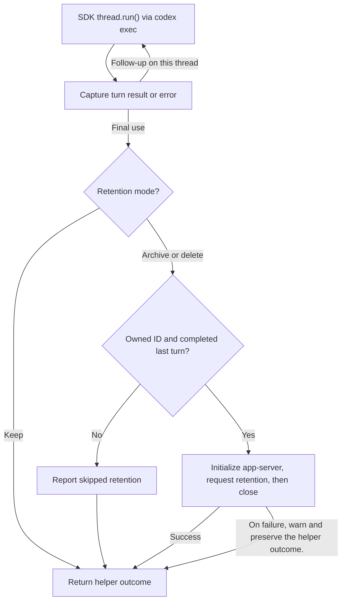
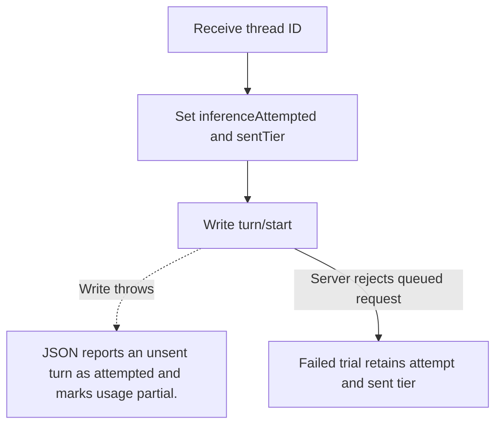
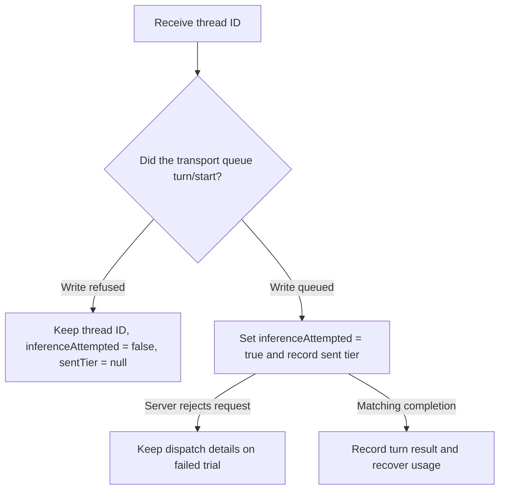
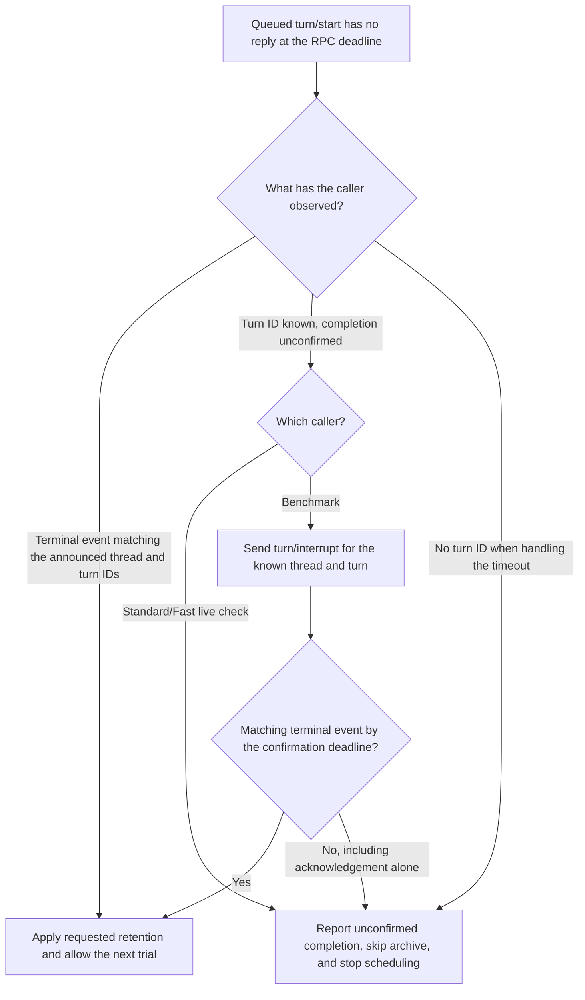
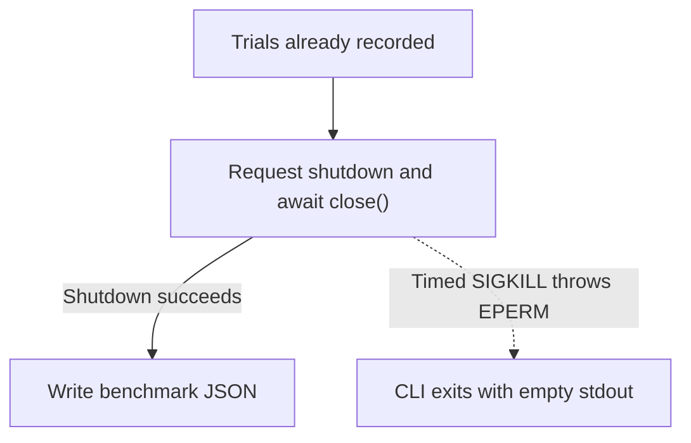
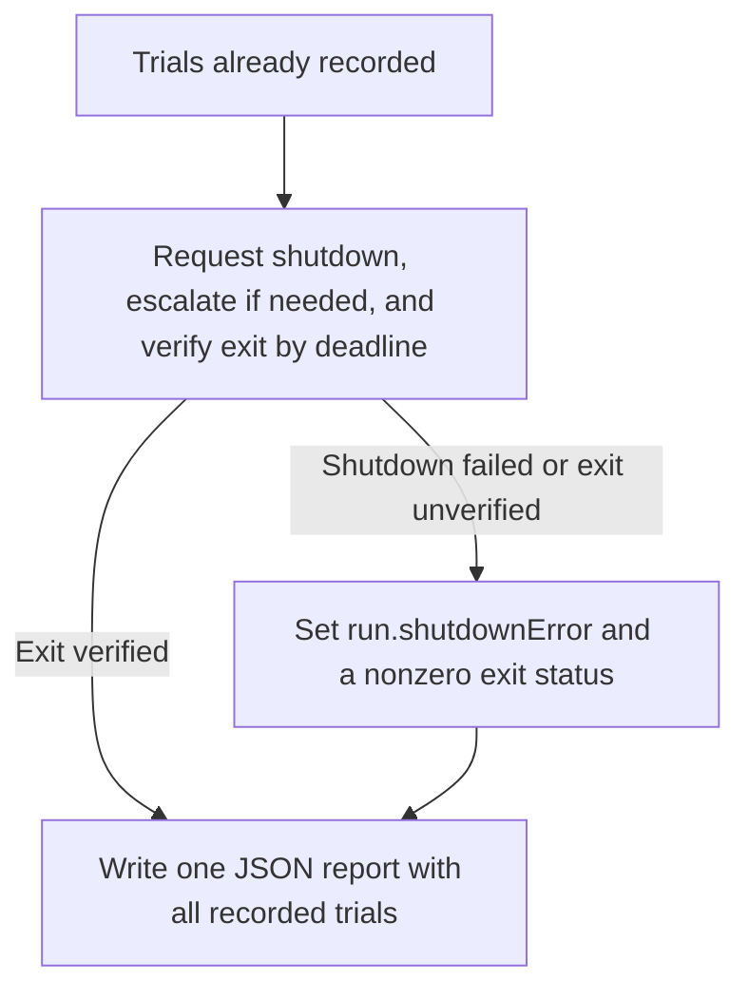

## Research question

When a Codex operation fails, what can the CLI still tell the user about the turn, saved session, and local process? The full suite passed on `v0.2.2-canary.6` with Codex 0.170.0. Two targeted benchmark checks on that source exposed a misreported attempt and a missing JSON report. Both used a Node CLI built from the tagged source, one warm-up, one measured trial, and a synthetic app-server. The normal control exited 0 with both turns and complete usage. The frequency of the injected failures in ordinary use is unknown. [Benchmark fixture](../../test/codex-benchmark/fixtures/benchmark-app-server.mjs)

The `v0.2.2-canary.7` dependency refresh moved the SDK and bundled CLI to 0.171.0 and passed all 4,639 tests. Separate checks against the built canary.7 CLI reproduced both failures with a synthetic app-server. How the native binary behaves under equivalent faults remains open. [Dependency refresh](../plans/jobs/2026-11-20-v0.2.2-canary.7-dependency-refresh.md) · [v0.2.2-canary.7 investigation](../plans/jobs/2026-11-20-canary-7-turn-reporting-and-shutdown.md)

## Scope by caller and test runner

| Caller or component | Scope of the proposal | Outcome to verify |
| --- | --- | --- |
| `codex-bench` | Direct turn dispatch, timeout recovery, and shared app-server shutdown. | Count queued writes as attempts. After an ambiguous start, require matching terminal evidence before archive or another trial. Preserve completed trials in JSON if shutdown fails. [Benchmark runner](../../src/adapters/codex/benchmark/index.ts) |
| Standard/Fast live check (developer tool) | Direct turn scheduling through its own app-server client. | Recover a matching Standard completion even if the start reply is missing. If completion is still unknown at timeout, skip archive and stop before Fast. [Live check](../../scripts/spikes/codex-benchmark-live-check.ts) |
| SDK helpers for rename, data query/stack, Markdown/PDF, and interactive workflows | Shared shutdown when a helper opens an app-server for archive or delete. Prompt execution through SDK `thread.run()` has a separate cancellation check. | Preserve the answer or original error and report failed or skipped retention. The default `keep` opens no retention app-server. [Command scope](../guides/codex-execution-configuration.md#command-scope) · [SDK helper entry point](../../src/adapters/codex/shared.ts) |
| `doctor` benchmark readiness check | Shared shutdown after the probe reads the app-server version. | Return a readiness diagnostic within the shutdown deadline. [Doctor probe](../../src/cli/doctor/codex-benchmark.ts) |
| `codex-info` discovery | Separate verification for `DiscoveryTransport`, which owns its shutdown. | Check discovery shutdown directly. The shared-close regression exercises a different transport. [Discovery](../../src/adapters/codex/discovery/index.ts) · [Transport](../../src/adapters/codex/discovery/transport.ts) |
| Managed application-suite runner | Test infrastructure for fixture cancellation and suite timing. | After cancellation, the active fixture records completion and the next fixture never acquires a PID. The cause of the original 300-second timeout remains open. [Test-runner evidence](#test-runner-evidence) |

## One helper session, from prompt to retention

For example, `data query codex` captures a SQL draft through the SDK. If the helper reuses a thread, it can finish follow-ups before retention runs. With the default `keep`, it opens no retention app-server. With `archive` or `delete`, it needs the owned thread ID and confirmation that its last turn completed. The wrapper uses the SDK result’s usage field as completion evidence. [SQL helper](../../src/cli/data-query/runner.ts) · [Thread lifecycle](../../src/adapters/codex/session-lifecycle.ts)

**cdx-chores v0.2.2-canary.6 helper session**

## When does a benchmark turn count as dispatched?

A successful `thread/start` supplies a session ID. On canary.6 the runner records the inference attempt and sent tier before writing `turn/start`. An attempted inference with missing counts makes the invocation’s usage total partial. [Benchmark runner](../../src/adapters/codex/benchmark/index.ts) · [Usage accounting](../../src/cli/codex-bench/usage.ts)

**Before — cdx-chores v0.2.2-canary.6 benchmark dispatch**

**Observed.** When the second write threw before queuing any bytes, the fixture received only the first turn. JSON showed an attempt and the `default` tier for the second. In the rejection control, the fixture received and rejected both requests. Recording both attempts was correct.

**Proposed — benchmark dispatch**

The acceptance check compares the trace with JSON. A refused local write should preserve earlier usage totals. A queued request should count even if Codex rejects it or its reply is lost.

## When can the next turn start if the start reply is missing?

**Observed on v0.2.2-canary.7.** The synthetic server announced Standard’s turn ID in every case. When it withheld the start reply but sent a matching completion before the 15-second RPC deadline, the benchmark recovered the result and archived Standard. The live check received the completion but reported a start timeout and skipped archive. When Standard stayed active through that deadline, neither caller sent an interrupt. The benchmark stopped scheduling, while the live check started Fast. A separate control delivered the start reply and let the 120-second completion wait expire. Only in that control did the benchmark interrupt the known turn and require a matching terminal event before continuing. [Withheld-reply investigation](../plans/jobs/2026-11-20-canary-7-withheld-turn-start-reply.md#full-deadline-observations)

**Proposed flow for a queued `turn/start` at the start RPC deadline**

The benchmark preserves the attempt and sent tier on every path. If it interrupts after the start timeout, it keeps the trial failed and reports any usage attributable to that turn, even when the terminal event permits archive and another trial.

**Regression case still to test.** If the caller has no turn ID when it handles the start RPC timeout, it stops scheduling immediately. A later announcement does not reopen that decision. Keep the start reply and announcement withheld until the caller exits. Check that the benchmark reports the thread ID, a null turn ID, and an attempted dispatch. For both callers, verify that the protocol trace ends without an interrupt, an archive request, or another turn start.

## What survives a shutdown failure?

At shutdown the benchmark already holds its trial records. On canary.6, a timer sends `SIGKILL` after one second of grace. If the timer callback throws, the error escapes the caller’s `await close()`. Catching and ignoring it could leave the CLI waiting indefinitely for the child, since the bounded group-exit check starts only after child closure. [App-server shutdown](../../src/adapters/codex/app-server.ts) · [Report writer](../../src/cli/commands/codex-bench.ts)

**Before — cdx-chores v0.2.2-canary.6 benchmark shutdown**

**Observed.** Both turns completed while the fixture delayed exit beyond the grace period. With escalation allowed, the CLI exited 0 and returned both results. When the group kill threw `EPERM`, the CLI exited 1 without writing either result.

**Proposed — benchmark shutdown**

**Regression check.** Deny escalation while the leader is alive. Require a bounded nonzero CLI exit and valid JSON containing both completed trials and the shutdown diagnostic. Independently observe the owned group before claiming that its workers exited.

**Other callers to verify.** Helper retention and the `doctor` probe share `CodexAppServer.close()`. The empty-stdout result was reproduced through the benchmark only. For helper retention, inject a shutdown failure after a successful SDK turn and check that the answer survives with a retention diagnostic. For `doctor`, check that the probe returns a diagnostic within a deadline. Assess `codex-info` separately through its discovery transport.

## Upstream applicability to Codex 0.171.0

The published TypeScript SDK JavaScript and declarations match 0.170.0. The native `codex exec` that runs helper prompts now uses the shared app-server client. The native app-server also ties each `turn/interrupt` reply to its target turn and returns an error if its thread listener shuts down. The synthetic Standard/Fast comparison established how our callers handle those events. Their ordering with the native server and a provider remains open. The benchmark still queues its own writes and runs its own shutdown timer. [Package comparison](../plans/jobs/2026-11-20-v0.2.2-canary.7-dependency-refresh.md#package-review) · [Native exec change](https://github.com/openai/codex/pull/61706) · [Interrupt ordering change](https://github.com/openai/codex/pull/62066)

All four issues below were open on 2026-11-20.

| Upstream evidence | What to check on 0.171.0 |
| --- | --- |
| On Linux, `events.return()` resolved while a streamed turn’s direct child was still alive after ignoring `SIGTERM`. Early iterator cleanup in 0.171.0 still requests termination without awaiting exit. [SDK #36658](https://github.com/openai/codex/issues/36658) · [Tagged SDK executor](https://github.com/openai/codex/blob/rust-v0.171.0/sdk/typescript/src/exec.ts#L248-L263) | Repeat the streamed control, then cancel a helper’s buffered `thread.run()` against the same fixture. Observe when the helper settles and when the child exits. |
| Closing a streamed iterator and immediately aborting its signal terminated the Node host with an unhandled `AbortError`. The SDK still removes the child’s listeners during cleanup. [SDK #51537](https://github.com/openai/codex/issues/51537) | In a disposable Node host, compare that sequence with a helper’s normal abort path. Record whether the helper rejects and whether the host survives. |
| On macOS, closing app-server stdin cut short stdio MCP cleanup and left descendants alive on 0.157.1 and 0.158.0. A Linux trace on 0.163.0 also showed premature termination after the parent sent `SIGTERM`. [App-server #48524](https://github.com/openai/codex/issues/48524) · [macOS follow-up](https://github.com/openai/codex/issues/48524#issuecomment-5882628955) · [Linux trace](https://github.com/openai/codex/issues/48524#issuecomment-6251417643) | Compare stdin EOF alone with the pipe closure and `SIGTERM` used by our transport. Check the MCP server’s cleanup marker, each process’s exit, and which descendants belong to the owned group. |
| The tagged `exec --json` code ends an interrupted turn without emitting a terminal JSON turn event. The native runner records a matching interruption as an error and exits nonzero. [Exec #50585](https://github.com/openai/codex/issues/50585) · [JSON event mapping](https://github.com/openai/codex/blob/rust-v0.171.0/codex-rs/exec/src/event_processor_with_jsonl_output.rs#L528-L568) · [Native exit handling](https://github.com/openai/codex/blob/rust-v0.171.0/codex-rs/exec/src/lib.rs#L1473-L1545) | Interrupt a helper turn with retention requested. Capture the SDK result or error, native exit status, and whether the helper skips retention for the interrupted turn. |

## Test-runner evidence

**What the receipts established.** In an earlier managed run, the application suite reached its 300-second deadline. The runner sent `SIGTERM` at 300.025 seconds. The active `raw-fragmented-arrows` fixture recorded `cancelled` and `stopped: true` after 0.852 seconds of its own 12-second allowance. Its `result.ok` assertion failed before the test compared the arrow-key behavior. The case passed five isolated repetitions. [Frame-menu fixture](../../test/video/interactive/fixtures/frames-menu-fixture.ts) · [Arrow-input test](../../test/video/interactive/frames-menu-bytes.app.test.ts)

Four more fixtures started after the cancelled fixture recorded completion. Three completed. The fourth had a start receipt and no completion receipt. The runner sent `SIGKILL` to the outer suite at 301.026 seconds and confirmed that it stopped. With the fourth fixture’s exit unverified, the runner retained scratch and skipped the Codex and Pandoc suites. The launcher installs and removes signal listeners for each fixture, so a later launch can miss a cancellation already delivered to the suite. A controlled canary.7 run confirmed that a second fixture acquired a PID after the first recorded a stopped cancellation. [v0.2.2-canary.7 investigation](../plans/jobs/2026-11-20-canary-7-turn-reporting-and-shutdown.md)

**Why the earlier suite reached 300 seconds remains open.** A focused run overlapped that invocation for about 56 seconds. All three subsequent isolated canary.7 runs finished within the allowance and crossed the 240-second reassessment threshold. Their timings identify where to profile current costs. The contribution of concurrent work or any test family to the earlier timeout is still unknown. [Timeout decision and measurement method](../plans/jobs/2026-10-18-application-test-costs-and-timeout-budgeting.md#timeout-decision)

## Implementation Direction

The canary.7 investigation supports the following changes and timing decision. Runtime fixes and their regression checks are pending. [v0.2.2-canary.7 investigation](../plans/jobs/2026-11-20-canary-7-turn-reporting-and-shutdown.md)

### Direct turn handling

- **Benchmark dispatch accounting.** Record the attempt and sent tier once the transport queues `turn/start`. A refused write preserves the thread ID and the completeness of earlier usage totals. A queued request still counts if the server rejects it or its reply is lost.
- **Benchmark start timeout.** Recover a cached terminal event for the announced turn. If completion is unconfirmed and the turn ID is known, use the existing targeted interrupt and bounded confirmation wait. If the ID or confirmation is still missing, skip archive and stop scheduling. [Proposed flow and regression case](#when-can-the-next-turn-start-if-the-start-reply-is-missing)
- **Standard/Fast live check.** Match a cached terminal event to Standard’s thread and turn IDs even if the start reply is missing. At either the start or completion deadline, report the timeout and end the comparison before archive or Fast if Standard’s completion remains unconfirmed.

### Shared app-server shutdown

Bound `CodexAppServer.close()` for the benchmark, SDK helper retention, and the `doctor` probe. Report the owned process group as stopped only after verifying its exit. On shutdown failure, the benchmark should emit one JSON report with all completed trials and `run.shutdownError`, then exit nonzero. Helpers that open the app-server to archive or delete should preserve the answer or original error and report the retention diagnostic. The probe should return a readiness diagnostic within the deadline. SDK prompt cancellation and shutdown through the separate `codex-info` discovery transport still need their own checks.

### Managed test runner

Remember cancellation for the lifetime of the application suite. Verify that the active fixture records its completion and that the next fixture never acquires a PID. The cause of the earlier suite timeout remains open. Keep the 300-second allowance while profiling the video and Codex benchmark test families.

## Related Plans

- [Codex CLI benchmark](../plans/plan-2026-11-18-codex-cli-benchmark.md)
- [Codex request timeout contract](../plans/plan-2026-08-21-codex-request-timeout-contract.md)
