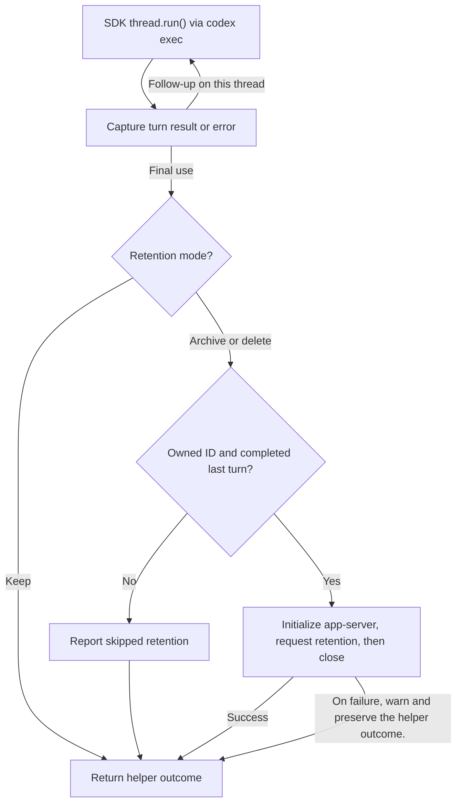
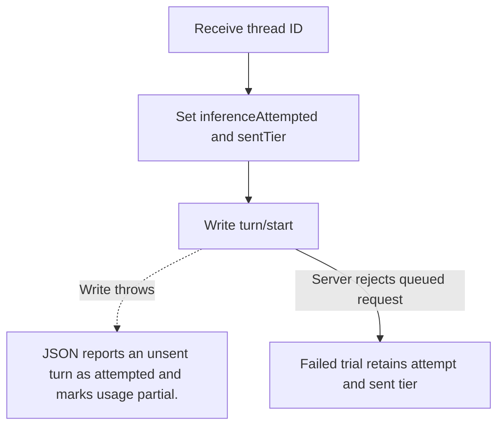
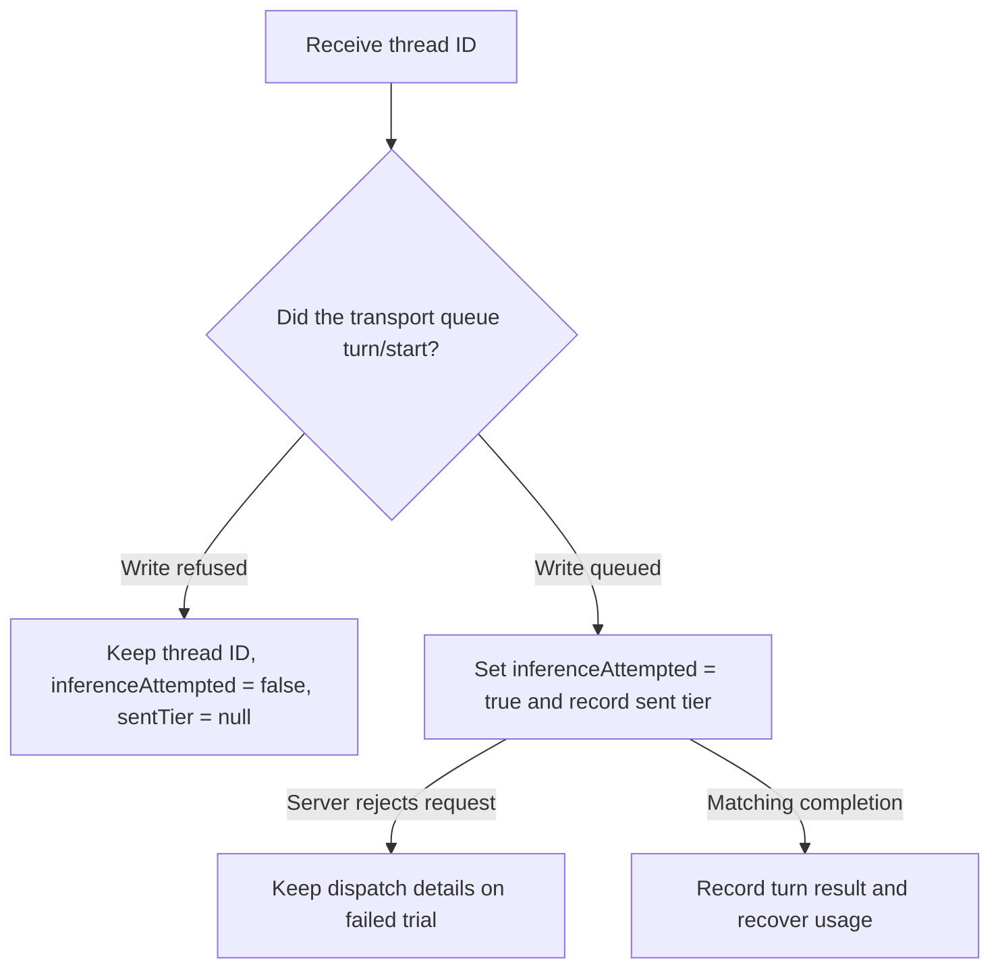
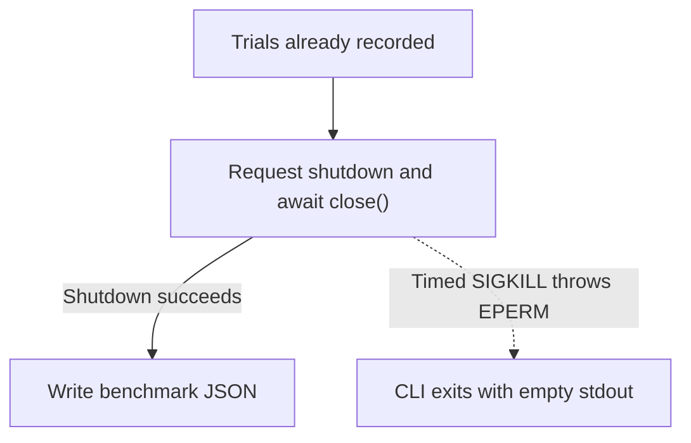
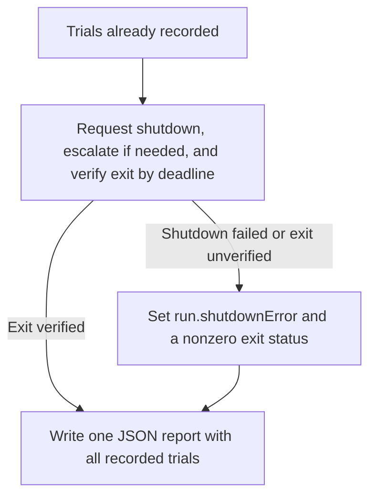

## Research question

When a Codex operation fails, what can the CLI still tell the user about the turn, saved session, and local process? The maintainer’s latest `bun run test:all` passed on `v0.2.2-canary.6`. Two targeted benchmark checks on that source exposed a misreported attempt and a missing JSON report. Both used a Node CLI built from the tagged source, one warm-up, one measured trial, and a synthetic app-server. The normal control exited 0 with both turns and complete usage. The frequency of the injected failures in ordinary use is unknown. [Benchmark fixture](../../test/codex-benchmark/fixtures/benchmark-app-server.mjs)

## Which commands talk to Codex?

| Command or action | How it uses Codex | What the caller needs back |
| --- | --- | --- |
| `codex-bench` | Talks directly to `codex app-server` for trial threads, turns, and retention. | A report containing the measurements already collected and any shutdown error. [Benchmark runner](../../src/adapters/codex/benchmark/index.ts) |
| Codex helpers for rename, data query/stack, Markdown/PDF, and interactive workflows | Run prompts through SDK `thread.run()` and `codex exec`. Helpers with archive or delete selected can open an app-server after final thread use. | The helper’s answer or original error, plus a diagnostic if requested retention failed or was skipped. Supported flags vary by command. [Command scope](../guides/codex-execution-configuration.md#command-scope) · [SDK helper entry point](../../src/adapters/codex/shared.ts) |
| `doctor` benchmark readiness check | Initializes an app-server, reads the reported version, and closes the connection. It creates no trial thread. | A readiness diagnostic. [Doctor probe](../../src/cli/doctor/codex-benchmark.ts) |
| `codex-info` discovery | Uses `DiscoveryTransport` to initialize an app-server, read configuration, and request model metadata when needed. | Discovery results. This transport has its own shutdown implementation. [Discovery](../../src/adapters/codex/discovery/index.ts) · [Transport](../../src/adapters/codex/discovery/transport.ts) |

## One helper session, from prompt to retention

For example, `data query codex` captures a SQL draft through the SDK. If the helper reuses a thread, it can finish follow-ups before retention runs. With the default `keep`, it opens no retention app-server. With `archive` or `delete`, it needs the owned thread ID and confirmation that its last turn completed. The wrapper uses the SDK result’s usage field as completion evidence. [SQL helper](../../src/cli/data-query/runner.ts) · [Thread lifecycle](../../src/adapters/codex/session-lifecycle.ts)

**Current — cdx-chores v0.2.2-canary.6 helper session**

## When does a benchmark turn count as dispatched?

A successful `thread/start` supplies a session ID. On canary.6 the runner records the inference attempt and sent tier before writing `turn/start`. An attempted inference with missing counts makes the invocation’s usage total partial. [Benchmark runner](../../src/adapters/codex/benchmark/index.ts) · [Usage accounting](../../src/cli/codex-bench/usage.ts)

**Before — cdx-chores v0.2.2-canary.6 benchmark dispatch**

**Observed.** When the second write threw before queuing any bytes, the fixture received only the first turn. JSON showed an attempt and the `default` tier for the second. In the rejection control, the fixture received and rejected both requests. Recording both attempts was correct.

**Proposed — benchmark dispatch**

The acceptance check compares the trace with JSON. A refused local write should preserve earlier usage totals. A queued request should count even if Codex rejects it or its reply is lost.

**Delayed completion still needs a separate test.** A start notification can identify an active turn even if the RPC reply is late. Withhold the reply and compare the trace when a matching terminal event arrives with the trace when it never arrives. Check when the runner interrupts, applies archive or delete, and starts another trial. For the manual live check, verify whether Fast can start while Standard may still be running. The dispatch checks above did not exercise this ordering. [Turn observer](../../src/adapters/codex/benchmark/turn.ts) · [Retention policy](../../src/adapters/codex/session-retention.ts) · [Manual live check](../../scripts/spikes/codex-benchmark-live-check.ts)

## What survives a shutdown failure?

At shutdown the benchmark already holds its trial records. On canary.6, a timer sends `SIGKILL` after one second of grace. If the timer callback throws, the error escapes the caller’s `await close()`. Catching and ignoring it could leave the CLI waiting indefinitely for the child, since the bounded group-exit check starts only after child closure. [App-server shutdown](../../src/adapters/codex/app-server.ts) · [Report writer](../../src/cli/commands/codex-bench.ts)

**Before — cdx-chores v0.2.2-canary.6 benchmark shutdown**

**Observed.** Both turns completed while the fixture delayed exit beyond the grace period. With escalation allowed, the CLI exited 0 and returned both results. When the group kill threw `EPERM`, the CLI exited 1 without writing either result.

**Proposed — benchmark shutdown**

**First fix to evaluate.** Deny escalation while the leader is alive. Require a bounded nonzero CLI exit and valid JSON containing both completed trials and the shutdown diagnostic. Independently observe the owned group before claiming that its workers exited.

**Other callers to verify.** Helper retention and the `doctor` probe share `CodexAppServer.close()`. The empty-stdout result was reproduced through the benchmark only. For helper retention, inject a shutdown failure after a successful SDK turn and check that the answer survives with a retention diagnostic. For `doctor`, check that the probe returns a diagnostic within a deadline. Assess `codex-info` separately through its discovery transport.

## Upstream applicability to 0.170.0

The lockfile resolves both `@openai/codex-sdk` and the native Codex CLI to `0.170.0`. Helpers submit prompts with the SDK’s `thread.run()` through `codex exec`. The benchmark launches `codex app-server` through its own transport. The three upstream reports were open on 2026-11-19. Each needs a check against the component and call sequence we ship. [Dependency lock](../../bun.lock) · [SDK helper lifecycle](../../src/adapters/codex/session-lifecycle.ts)

| Upstream observation | Evidence still needed |
| --- | --- |
| On Linux, a streamed iterator’s `events.return()` resolved while a direct child that ignored `SIGTERM` was still alive. [SDK #36658](https://github.com/openai/codex/issues/36658) | Repeat the streamed control on SDK 0.170.0, then cancel a helper’s actual `thread.run()` against the same child. Record when the helper settles and whether the child is still alive. |
| Closing a streamed iterator and immediately aborting its signal crashed the Node host with an unhandled `AbortError` in an upstream checkout. [SDK #51537](https://github.com/openai/codex/issues/51537) | Compare that ordering with the helper’s normal abort path on 0.170.0 in a disposable Node host. Distinguish a rejected operation from an exception that terminates the host. |
| Closing stdin on native CLI 0.157.1 could interrupt stdio MCP cleanup and leave a descendant alive on macOS. [App-server #48524](https://github.com/openai/codex/issues/48524) | Exercise native CLI 0.170.0 with a controlled MCP child. Observe the server, child, and descendant separately, including which processes belong to the owned group. |

These reports identify cases worth testing. The local report-loss reproduction used a synthetic server and already identifies a failure in our timer. An SDK upgrade or broader process supervisor would need evidence that it addresses a failure on the relevant production path. The scope of `v0.2.2-canary.7` remains open.

## Test-runner evidence

An earlier application-suite timeout cancelled an active frame-menu fixture. Later fixtures still started, and the runner retained scratch when one lacked a completion receipt. The named arrow-input case passed five isolated repetitions. Investigate whether suite cancellation prevents the next fixture from launching as a separate runner question. The passing canary.6 suite and the earlier timeout are both relevant to test reliability. Neither establishes an SDK defect. [Fixture launcher](../../scripts/testing/fixtures/fixture-process.ts)

## Related Plans

- [Codex CLI benchmark](../plans/plan-2026-11-18-codex-cli-benchmark.md)
- [Codex request timeout contract](../plans/plan-2026-08-21-codex-request-timeout-contract.md)
