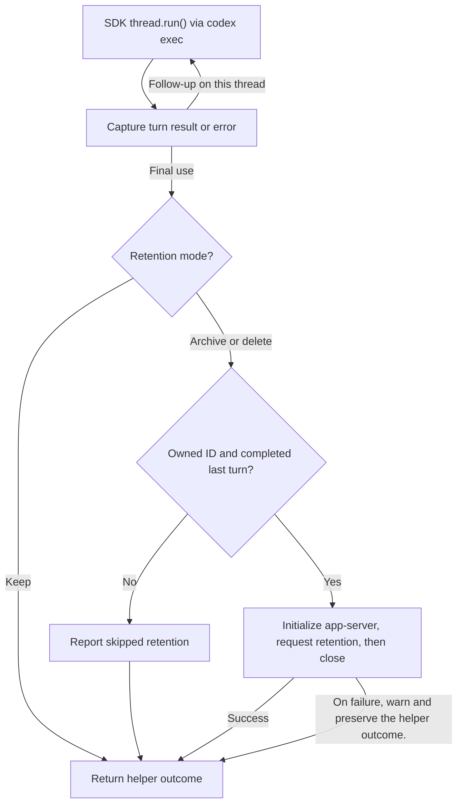
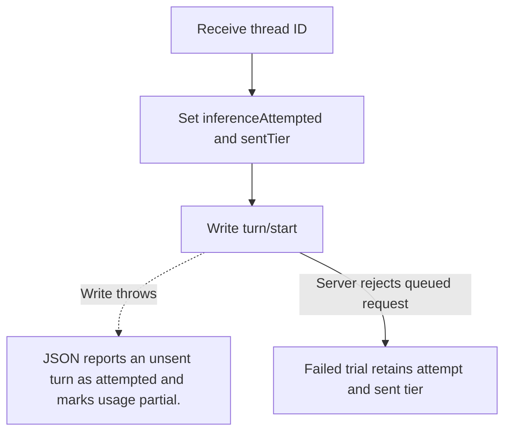
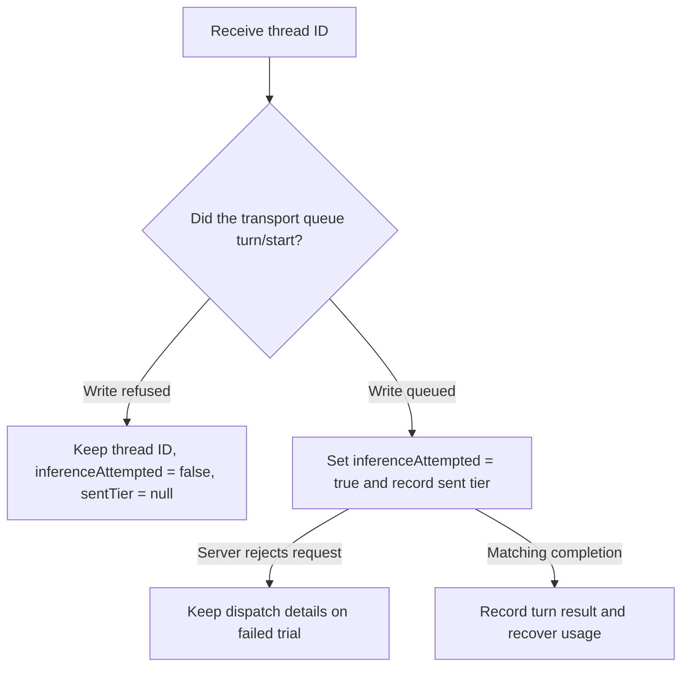
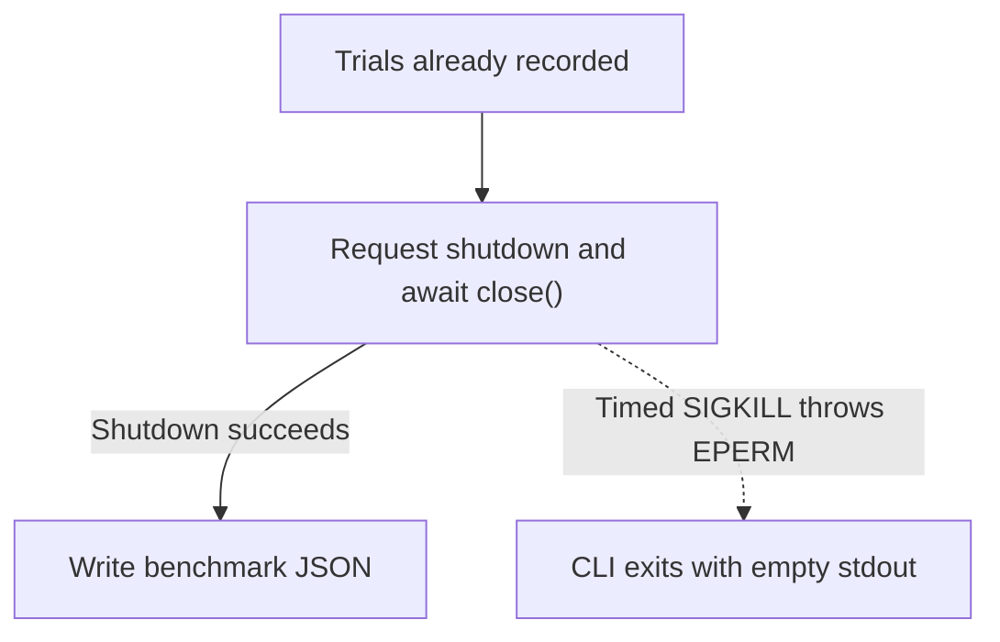
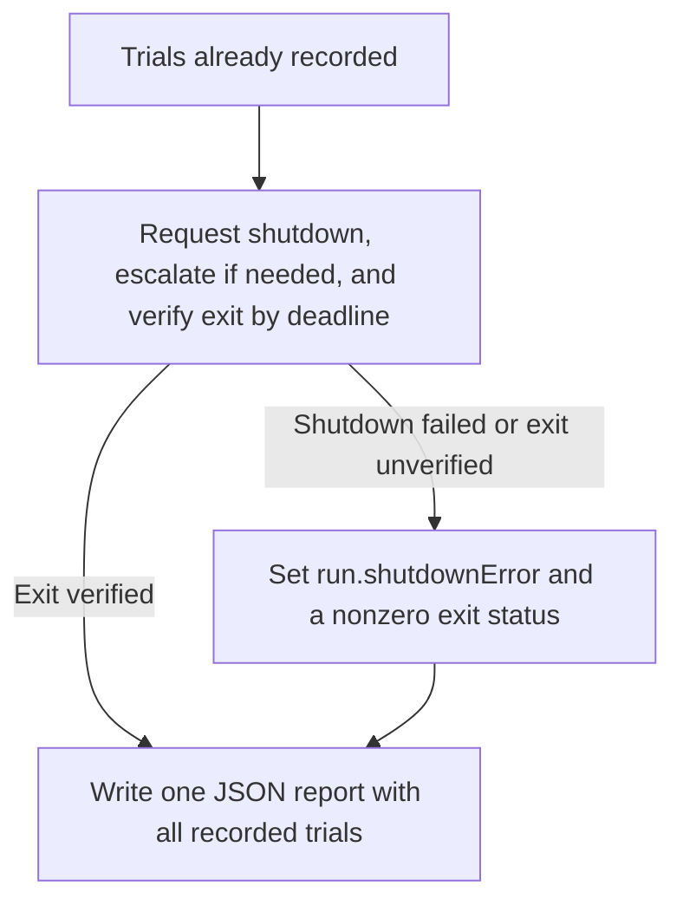

## Research question

When a Codex operation fails, what can the CLI still tell the user about the turn, saved session, and local process? The full suite passed on `v0.2.2-canary.6` with Codex 0.170.0. Two targeted benchmark checks on that source exposed a misreported attempt and a missing JSON report. Both used a Node CLI built from the tagged source, one warm-up, one measured trial, and a synthetic app-server. The normal control exited 0 with both turns and complete usage. The frequency of the injected failures in ordinary use is unknown. [Benchmark fixture](../../test/codex-benchmark/fixtures/benchmark-app-server.mjs)

The `v0.2.2-canary.7` dependency refresh moved the SDK and bundled CLI to 0.171.0 and passed all 4,639 tests. The benchmark dispatch and shutdown code is unchanged from canary.6. Repeating the two injected failures on canary.7 remains open. [Dependency refresh and verification](../plans/jobs/2026-11-20-v0.2.2-canary.7-dependency-refresh.md)

## Which commands talk to Codex?

| Command or action | How it uses Codex | What the caller needs back |
| --- | --- | --- |
| `codex-bench` | Talks directly to `codex app-server` for trial threads, turns, and retention. | A report containing the measurements already collected and any shutdown error. [Benchmark runner](../../src/adapters/codex/benchmark/index.ts) |
| Codex helpers for rename, data query/stack, Markdown/PDF, and interactive workflows | Run prompts through SDK `thread.run()` and `codex exec`. Helpers with archive or delete selected can open an app-server after final thread use. | The helper’s answer or original error, plus a diagnostic if requested retention failed or was skipped. Supported flags vary by command. [Command scope](../guides/codex-execution-configuration.md#command-scope) · [SDK helper entry point](../../src/adapters/codex/shared.ts) |
| `doctor` benchmark readiness check | Initializes an app-server, reads the reported version, and closes the connection. It creates no trial thread. | A readiness diagnostic. [Doctor probe](../../src/cli/doctor/codex-benchmark.ts) |
| `codex-info` discovery | Uses `DiscoveryTransport` to initialize an app-server, read configuration, and request model metadata when needed. | Discovery results. This transport has its own shutdown implementation. [Discovery](../../src/adapters/codex/discovery/index.ts) · [Transport](../../src/adapters/codex/discovery/transport.ts) |

## One helper session, from prompt to retention

For example, `data query codex` captures a SQL draft through the SDK. If the helper reuses a thread, it can finish follow-ups before retention runs. With the default `keep`, it opens no retention app-server. With `archive` or `delete`, it needs the owned thread ID and confirmation that its last turn completed. The wrapper uses the SDK result’s usage field as completion evidence. [SQL helper](../../src/cli/data-query/runner.ts) · [Thread lifecycle](../../src/adapters/codex/session-lifecycle.ts)

**cdx-chores v0.2.2-canary.6 helper session**

## When does a benchmark turn count as dispatched?

A successful `thread/start` supplies a session ID. On canary.6 the runner records the inference attempt and sent tier before writing `turn/start`. An attempted inference with missing counts makes the invocation’s usage total partial. [Benchmark runner](../../src/adapters/codex/benchmark/index.ts) · [Usage accounting](../../src/cli/codex-bench/usage.ts)

**Before — cdx-chores v0.2.2-canary.6 benchmark dispatch**

**Observed.** When the second write threw before queuing any bytes, the fixture received only the first turn. JSON showed an attempt and the `default` tier for the second. In the rejection control, the fixture received and rejected both requests. Recording both attempts was correct.

**Proposed — benchmark dispatch**

The acceptance check compares the trace with JSON. A refused local write should preserve earlier usage totals. A queued request should count even if Codex rejects it or its reply is lost.

**Delayed completion still needs a separate test.** A start notification can identify an active turn even if the RPC reply is late. Withhold the reply and compare the trace when a matching terminal event arrives with the trace when it never arrives. Check when the runner interrupts, applies archive or delete, and starts another trial. For the manual live check, verify whether Fast can start while Standard may still be running. The dispatch checks above did not exercise this ordering. [Turn observer](../../src/adapters/codex/benchmark/turn.ts) · [Retention policy](../../src/adapters/codex/session-retention.ts) · [Manual live check](../../scripts/spikes/codex-benchmark-live-check.ts)

## What survives a shutdown failure?

At shutdown the benchmark already holds its trial records. On canary.6, a timer sends `SIGKILL` after one second of grace. If the timer callback throws, the error escapes the caller’s `await close()`. Catching and ignoring it could leave the CLI waiting indefinitely for the child, since the bounded group-exit check starts only after child closure. [App-server shutdown](../../src/adapters/codex/app-server.ts) · [Report writer](../../src/cli/commands/codex-bench.ts)

**Before — cdx-chores v0.2.2-canary.6 benchmark shutdown**

**Observed.** Both turns completed while the fixture delayed exit beyond the grace period. With escalation allowed, the CLI exited 0 and returned both results. When the group kill threw `EPERM`, the CLI exited 1 without writing either result.

**Proposed — benchmark shutdown**

**First fix to evaluate.** Deny escalation while the leader is alive. Require a bounded nonzero CLI exit and valid JSON containing both completed trials and the shutdown diagnostic. Independently observe the owned group before claiming that its workers exited.

**Other callers to verify.** Helper retention and the `doctor` probe share `CodexAppServer.close()`. The empty-stdout result was reproduced through the benchmark only. For helper retention, inject a shutdown failure after a successful SDK turn and check that the answer survives with a retention diagnostic. For `doctor`, check that the probe returns a diagnostic within a deadline. Assess `codex-info` separately through its discovery transport.

## Upstream applicability to Codex 0.171.0

The published TypeScript SDK JavaScript and declarations match 0.170.0. The native `codex exec` that runs helper prompts now uses the shared app-server client. The native app-server also ties each `turn/interrupt` reply to its target turn and returns an error if its thread listener shuts down. For the Standard/Fast check, record the target turn ID, interrupt reply, and matching terminal event before evaluating when Fast started. The benchmark still queues its own writes and runs its own shutdown timer. [Package comparison](../plans/jobs/2026-11-20-v0.2.2-canary.7-dependency-refresh.md#package-review) · [Native exec change](https://github.com/openai/codex/pull/61706) · [Interrupt ordering change](https://github.com/openai/codex/pull/62066)

All four issues below were open on 2026-11-20.

| Upstream evidence | What to check on 0.171.0 |
| --- | --- |
| On Linux, `events.return()` resolved while a streamed turn’s direct child was still alive after ignoring `SIGTERM`. Early iterator cleanup in 0.171.0 still requests termination without awaiting exit. [SDK #36658](https://github.com/openai/codex/issues/36658) · [Tagged SDK executor](https://github.com/openai/codex/blob/rust-v0.171.0/sdk/typescript/src/exec.ts#L248-L263) | Repeat the streamed control, then cancel a helper’s buffered `thread.run()` against the same fixture. Observe when the helper settles and when the child exits. |
| Closing a streamed iterator and immediately aborting its signal terminated the Node host with an unhandled `AbortError`. The SDK still removes the child’s listeners during cleanup. [SDK #51537](https://github.com/openai/codex/issues/51537) | In a disposable Node host, compare that sequence with a helper’s normal abort path. Record whether the helper rejects and whether the host survives. |
| On macOS, closing app-server stdin cut short stdio MCP cleanup and left descendants alive on 0.157.1 and 0.158.0. A Linux trace on 0.163.0 also showed premature termination after the parent sent `SIGTERM`. [App-server #48524](https://github.com/openai/codex/issues/48524) · [macOS follow-up](https://github.com/openai/codex/issues/48524#issuecomment-5882628955) · [Linux trace](https://github.com/openai/codex/issues/48524#issuecomment-6251417643) | Compare stdin EOF alone with the pipe closure and `SIGTERM` used by our transport. Check the MCP server’s cleanup marker, each process’s exit, and which descendants belong to the owned group. |
| The tagged `exec --json` code ends an interrupted turn without emitting a terminal JSON turn event. The native runner records a matching interruption as an error and exits nonzero. [Exec #50585](https://github.com/openai/codex/issues/50585) · [JSON event mapping](https://github.com/openai/codex/blob/rust-v0.171.0/codex-rs/exec/src/event_processor_with_jsonl_output.rs#L528-L568) · [Native exit handling](https://github.com/openai/codex/blob/rust-v0.171.0/codex-rs/exec/src/lib.rs#L1473-L1545) | Interrupt a helper turn with retention requested. Capture the SDK result or error, native exit status, and whether the helper skips retention for the interrupted turn. |

## Test-runner evidence

**What the receipts established.** In an earlier managed run, the application suite reached its 300-second deadline. The runner sent `SIGTERM` at 300.025 seconds. The active `raw-fragmented-arrows` fixture recorded `cancelled` and `stopped: true` after 0.852 seconds of its own 12-second allowance. Its `result.ok` assertion failed before the test compared the arrow-key behavior. The case passed five isolated repetitions. [Frame-menu fixture](../../test/video/interactive/fixtures/frames-menu-fixture.ts) · [Arrow-input test](../../test/video/interactive/frames-menu-bytes.app.test.ts)

Four more fixtures started after the cancelled fixture recorded completion. Three completed. The fourth had a start receipt and no completion receipt. The runner sent `SIGKILL` to the outer suite at 301.026 seconds and confirmed that it stopped. With the fourth fixture’s exit unverified, the runner retained scratch and skipped the Codex and Pandoc suites. The launcher installs and removes signal listeners for each fixture, so a later launch can miss a cancellation already delivered to the suite. A focused regression should cancel the suite during fixture A, verify A’s completion receipt, and check that a subsequent attempt to launch fixture B allocates no child PID. [Fixture launch and receipt verification](../../scripts/testing/fixtures/fixture-process.ts)

**Why the suite reached 300 seconds remains open.** A separate focused run overlapped the failed invocation for about 56 seconds. In one passing run the benchmark-runner cases accounted for 45.7 seconds of summed case time. How much either factor contributed to the timeout is unknown. The repository calls for reassessment after any timeout or repeated runs above 240 seconds. Repeat the application suite in isolation with the same Node and Bun versions, compare test-process elapsed times across equivalent runs, and use per-case timings to locate the largest costs before changing the allowance. [Timeout decision and measurement method](../plans/jobs/2026-10-18-application-test-costs-and-timeout-budgeting.md#timeout-decision)

## Related Plans

- [Codex CLI benchmark](../plans/plan-2026-11-18-codex-cli-benchmark.md)
- [Codex request timeout contract](../plans/plan-2026-08-21-codex-request-timeout-contract.md)
