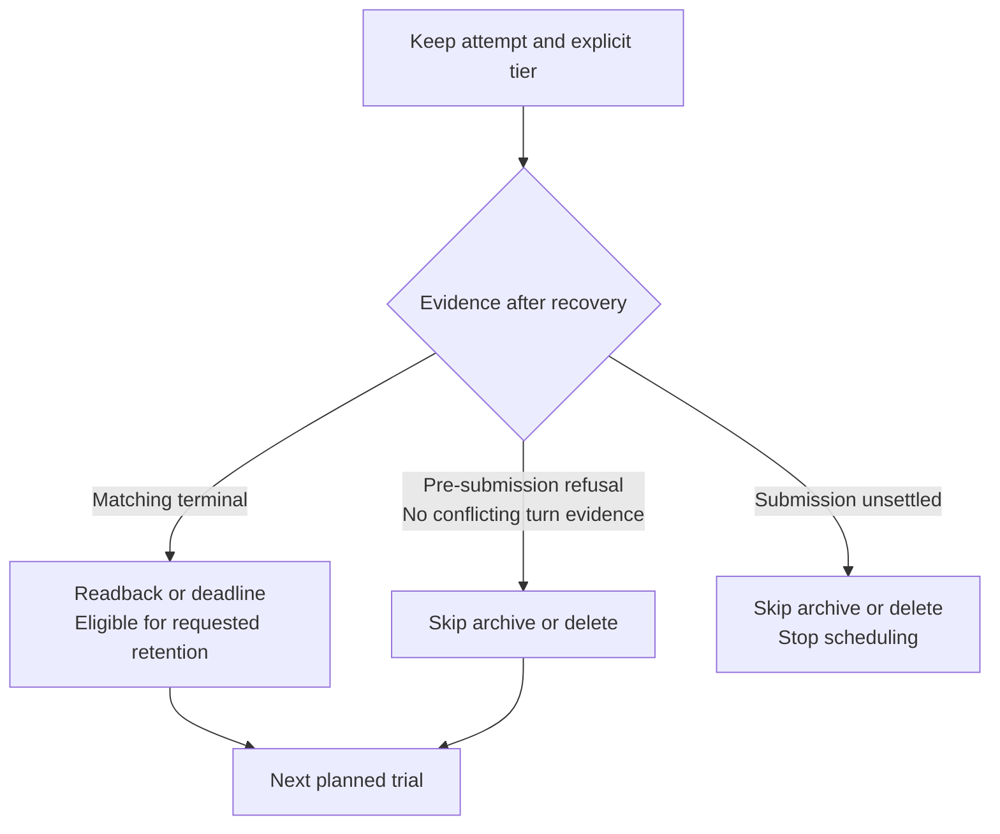

## Recommended caller behavior

- **Dispatch.** Require a fresh, nonempty thread ID before dispatch. Count a `codex-bench` attempt and record any explicit `sentTier` when app-server stdin accepts the client’s `turn/start` write. Have the Standard/Fast live check use the same evidence for `sentTier`. A proven local refusal leaves the trial unattempted and can permit the next planned trial. Continuation requires a healthy connection and an uncancelled run. [^transport] [^usage] [^benchmark] [^live]
- **Retention and scheduling.** A matching `turn/completed` for the owned thread and turn permits archive or delete after readback or its deadline. Preserve `data.input_error_code` in both callers to recognize refusals before Core submission, such as `input_too_large`. With no conflicting turn evidence, a recognized refusal permits the next planned trial on a healthy, uncancelled connection and skips archive or delete. Ambiguous submission without confirmed completion stops scheduling and skips archive or delete. Keep the callers’ existing timeout and interrupt policies. [^benchmark] [^live] [^retention] [^native-turn-start]
- **Shutdown.** Keep the existing contract. Require child `close` and, for a separately owned POSIX group, a signal 0 probe that returns `ESRCH`. [^shutdown]

**Proposed behavior after local stdin acceptance**

## Evidence

### Client dispatch

In the refusal probe, the server closed stdin before replying to the measured `thread/start`. The client saw writable stdin before the `turn/start` write in both cases below. Today, `codex-bench` calls `onQueued` when `write()` returns without throwing. Checking `stdin.errored` before the callback distinguishes peer closure from backpressure. [^transport] [^dispatch]

| Measured `write()` returned `false` | Server trace | Current report | Recommended report |
| --- | --- | --- | --- |
| Immediate `EPIPE` | Warm-up only | `inferenceAttempted: true`, `sentTier: "default"`. The 230-token total is marked partial. | `inferenceAttempted: false`, `sentTier: null`. The 230-token total stays complete. |
| Backpressure with bytes buffered and no immediate error | One measured `turn/start` after warm-up | Attempt recorded with `sentTier: "default"` | Same as current |

When a separate benchmark write threw before submitting bytes, the benchmark recorded no attempt and stopped despite a healthy transport. When stdout closed after the server received the measured request, the benchmark correctly preserved the attempt and tier. The live check currently reports the selected tier even if `thread/start` is rejected or peer-closed stdin prevents the `turn/start` write. [^runner-tests] [^benchmark] [^live]

### Core submission

Native Codex CLI 0.171.0 rejected oversized text on a fresh thread with `-32602` and `data.input_error_code: "input_too_large"`. The rejected thread emitted zero `turn/started` or `turn/completed` through child `close`. A valid request on another fresh thread produced matching lifecycle events. The fixture provider received exactly one request across both cases.

The tagged app-server checks input size before calling Core. Accepted start or steer outcomes return a turn ID, and Core documents that declined input is neither recorded nor enqueued. Source inspection also shows that Core enqueues input before awaiting its internal reply. Losing that reply returns `InternalAgentDied`, which app-server maps to an internal RPC error. Event ordering for other native rejections remains unverified. [^native-turn-start] [^native-core] [^native-reply-loss]

Both callers currently allow another trial after a generic `turn/start` RPC rejection if no turn is known. The synthetic regressions exercise that behavior. [^benchmark] [^live] [^runner-tests] [^recovery]

### Turn identity and completion

In a synthetic live-check probe, reusing thread and turn IDs let one Standard terminal event count as two completions. The live check sent two `thread/archive` requests for the same thread and exited 0 after the fixture acknowledged both. The benchmark rejected the duplicate thread ID before a second `turn/start`. [^live] [^benchmark]

Both callers can recover a missing start reply from `turn/started` and a matching `turn/completed` before the start deadline. On an unconfirmed timeout, the benchmark can interrupt a known turn and await its terminal event. The live check stops. A saved `task_complete` can supply timings and helps establish complete usage. The matching live event can authorize retention even when that saved record is absent. [^benchmark] [^live] [^retention] [^recovery]

### Shutdown

The automated suites cover denied escalation for both callers and undelivered escalation for the benchmark. In a separate live-check probe, the group-directed `SIGKILL` call reported success with delivery suppressed. The live check exited 1 with both completed Standard/Fast results and a shutdown deadline diagnostic on stderr. The leader and worker were still alive at caller exit. Cleanup outside the owned POSIX group, Windows descendant cleanup and fault frequency remain unverified. [^shutdown-tests] [^shutdown-record] [^earlier]

## Regression coverage to add

- **Dispatch and scheduling.** Cover healthy local refusal, immediate `EPIPE`, backpressure and transport loss after local acceptance. Replace generic-rejection continuation expectations with cases for structured refusal, generic errors and conflicting turn evidence. Assert attempt and tier accounting alongside scheduling and retention decisions. [^dispatch] [^runner-tests] [^recovery]
- **Turn identity.** Verify that duplicate thread IDs prevent a second start and archive, with distinct IDs as the control. [^live] [^recovery]
- **Shutdown and test ownership.** Automate the live check’s undelivered `SIGKILL` case, including exit 1, the deadline diagnostic, both surviving processes at exit and both retained results. Move the turn-recovery and shutdown suites from the fixed manual launcher to a test-owned launcher. [^recovery] [^shutdown-tests] [^launcher]

## Related Plans

- [Codex turn reporting and app-server shutdown](../plans/plan-2026-11-20-codex-turn-reporting-and-app-server-shutdown.md)
- [Codex CLI benchmark](../plans/plan-2026-11-18-codex-cli-benchmark.md)

## References

[^transport]: [App-server requests and stream errors](../../src/adapters/codex/app-server.ts)
[^usage]: [Benchmark token accounting](../../src/cli/codex-bench/usage.ts)
[^dispatch]: [Dispatch accounting cases](../../test/codex-benchmark/dispatch-accounting.app.test.ts) · [Local refusal and backpressure controls](../../test/codex-benchmark/fixtures/turn-write-preload.cjs)
[^runner-tests]: [Benchmark runner cases](../../test/codex-benchmark/benchmark-runner.app.test.ts)
[^live]: [Standard/Fast live check](../../scripts/spikes/codex-benchmark-live-check.ts)
[^benchmark]: [Benchmark runner](../../src/adapters/codex/benchmark/index.ts) · [Turn observer](../../src/adapters/codex/benchmark/turn.ts)
[^retention]: [Shared session retention](../../src/adapters/codex/session-retention.ts) · [Rollout recovery cases](../../test/codex-benchmark/rollout-recovery.app.test.ts)
[^recovery]: [Turn recovery cases](../../test/codex-benchmark/turn-recovery.app.test.ts) · [Recorded caller comparison](../plans/jobs/2026-11-20-codex-turn-reporting-and-app-server-shutdown.md#phase-2-turn-recovery-and-scheduling)
[^native-turn-start]: [Codex 0.171.0 structured input error](https://github.com/openai/codex/blob/rust-v0.171.0/codex-rs/app-server/src/request_processors/turn_processor.rs#L558-L568) · [Size check before submission](https://github.com/openai/codex/blob/rust-v0.171.0/codex-rs/app-server/src/request_processors/turn_processor.rs#L627-L635) · [Submission outcomes](https://github.com/openai/codex/blob/rust-v0.171.0/codex-rs/app-server/src/request_processors/turn_processor.rs#L722-L773) · [Reply containing the turn ID](https://github.com/openai/codex/blob/rust-v0.171.0/codex-rs/app-server/src/request_processors/turn_processor.rs#L789-L804)
[^native-core]: [Codex 0.171.0 Core submission contract](https://github.com/openai/codex/blob/rust-v0.171.0/codex-rs/core/src/codex_thread.rs#L599-L616)
[^native-reply-loss]: [Codex 0.171.0 Core queue and internal reply](https://github.com/openai/codex/blob/rust-v0.171.0/codex-rs/core/src/session/mod.rs#L1237-L1266) · [App-server submission error mapping](https://github.com/openai/codex/blob/rust-v0.171.0/codex-rs/app-server/src/request_processors/turn_processor.rs#L741-L749)
[^shutdown]: [Shared app-server shutdown](../../src/adapters/codex/app-server-shutdown.ts) · [Benchmark CLI exit handling](../../src/cli/commands/codex-bench.ts)
[^shutdown-tests]: [Shared shutdown cases](../../test/codex-benchmark/shared-shutdown.app.test.ts)
[^shutdown-record]: [Live-check shutdown and benchmark exit handling](../plans/jobs/2026-11-20-codex-app-server-version-parsing.md#fourth-follow-up-live-check-worker-shutdown)
[^launcher]: [Manual lifecycle launcher](../../scripts/spikes/codex-turn-lifecycle/live.ts)
[^earlier]: [Earlier turn reporting and process shutdown research](research-2026-11-19-codex-turn-reporting-and-process-shutdown.md)
