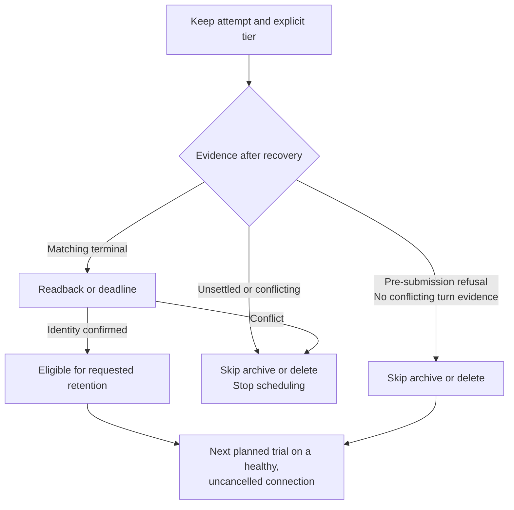
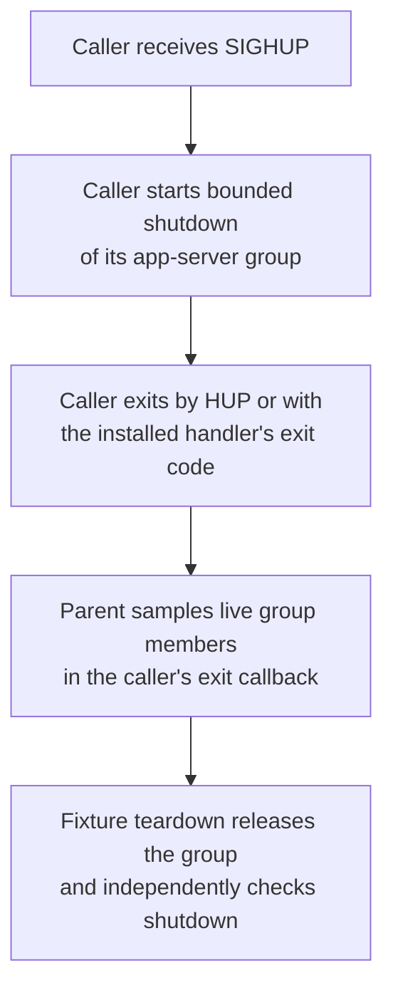
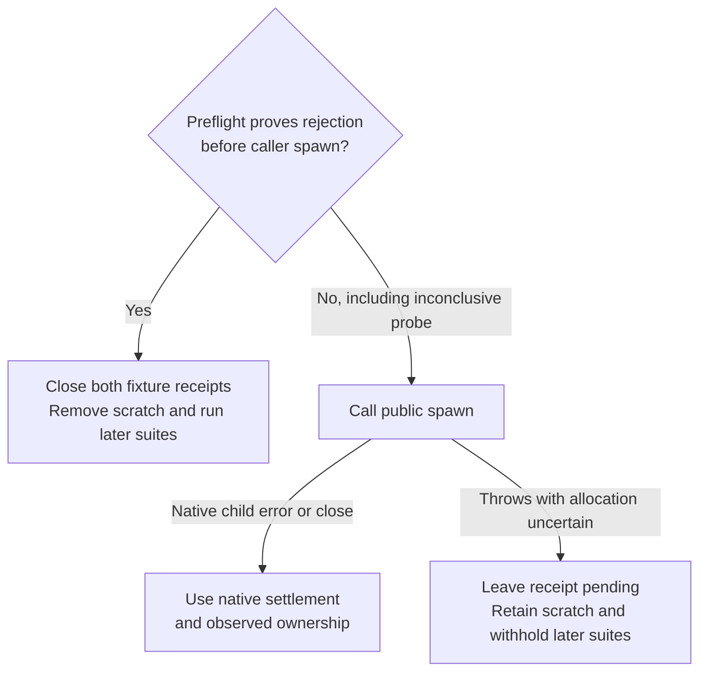

Part I records the verified benchmark design. Part II records who cleans up a detached app-server group on hangup and what evidence lets the managed runner conclude that the requested process never started.

## Part I — Benchmark lifecycle decisions

### Implemented caller behavior

Both callers require a fresh, nonempty thread ID and use local stdin acceptance of `turn/start` to record an explicit `sentTier`. The benchmark also records `inferenceAttempted`. A proven local refusal can allow the next planned trial. Continuation requires a healthy connection and an uncancelled run. [^transport] [^usage] [^benchmark] [^live]

After local acceptance, a recognized pre-submission refusal can also permit continuation without archive or delete. Both callers recognize the structured `input_too_large` error when no conflicting turn evidence has been observed. An unsettled start after recovery stops the workload. A matching live terminal event can permit retention after readback or its deadline. A conflicting start during readback prevents retention. If a retention request is already in flight when the conflict arrives, both callers preserve its result and stop scheduling. [^benchmark] [^live] [^retention] [^native-turn-start]

**Decision after local stdin acceptance**

The guide describes report fields and caller-specific deadlines. The implementation record contains the validation evidence. [Benchmark guide](../guides/codex-benchmark.md) · [Implementation record](../plans/jobs/2026-11-20-codex-benchmark-lifecycle-corrections.md)

### Evidence

#### Client dispatch

In the refusal probe, the server closed stdin before replying to the measured `thread/start`. The client saw writable stdin before the `turn/start` write in both cases below. Previously, `codex-bench` called `onQueued` when `write()` returned without throwing. Both callers now check for an immediate stream error before the callback. [^transport] [^dispatch]

| Measured `write()` returned `false` | Server trace | Benchmark before correction | Verified benchmark report |
| --- | --- | --- | --- |
| Immediate `EPIPE` | Warm-up only | `inferenceAttempted: true`, `sentTier: "default"`. The 230-token total is marked partial. | `inferenceAttempted: false`, `sentTier: null`. The 230-token total stays complete. |
| Backpressure with bytes buffered and no immediate error | One measured `turn/start` after warm-up | Attempt recorded with `sentTier: "default"` | Attempt recorded with `sentTier: "default"` |

The regression suite also covers a local write refusal on a healthy connection. Both callers skip retention for that thread and can proceed to the next planned trial. Later transport loss preserves the accepted attempt and tier and stops scheduling. The live check reports a null `sentTier` when `thread/start` fails or stdin refuses the `turn/start` write. [^dispatch] [^runner-tests] [^benchmark] [^live]

#### Core submission

Native Codex CLI 0.171.0 rejected oversized text on a fresh thread with `-32602` and `data.input_error_code: "input_too_large"`. The rejected thread emitted zero `turn/started` or `turn/completed` through child `close`. A valid request on another fresh thread produced matching lifecycle events. The fixture provider received exactly one request across both cases.

The tagged app-server checks input size before calling Core. Accepted start or steer outcomes return a turn ID, and Core documents that declined input is neither recorded nor enqueued. Source inspection also shows that Core enqueues input before awaiting its internal reply. Losing that reply returns `InternalAgentDied`, which app-server maps to an internal RPC error. Event ordering for other native rejections remains unverified. [^native-turn-start] [^native-core] [^native-reply-loss]

Before the corrections, both callers could schedule another trial after a generic `turn/start` error with no known turn. The synthetic regressions verify that the structured refusal can permit continuation and that a generic error or conflicting turn evidence stops scheduling while completion is unconfirmed. [^benchmark] [^live] [^runner-tests] [^recovery]

#### Turn identity and completion

Before the corrections, one synthetic live-check probe reused thread and turn IDs so that one Standard terminal event counted as two completions. The live check sent two archives for the same thread and exited 0 after the fixture acknowledged both. The benchmark rejected the duplicate ID before dispatch. The regression suite now verifies that both callers reject a reused or malformed thread ID before dispatch or retention. [^live] [^benchmark] [^recovery]

Both callers can recover a missing start reply from `turn/started` and a matching `turn/completed` before the start deadline. On an unconfirmed timeout, the benchmark can interrupt a known turn and await its terminal event. The live check stops. A saved `task_complete` can supply timings and helps establish complete usage. The matching live event can authorize retention even when that saved record is absent. [^benchmark] [^live] [^retention] [^recovery]

The regressions exercise a contradictory start notification and a contradictory original RPC reply arriving during readback. They also cover a conflict after archive is sent. When a conflict invalidates the benchmark turn ID, its JSON row clears the timings and throughput, excludes the trial from summaries, and preserves attributable token usage as partial. A known turn ID can still support saved timings on a failed trial. [^recovery] [^record]

#### Shutdown

Both callers require child `close` for successful shutdown and require a signal-zero probe to return `ESRCH` for a separately owned POSIX group. In the synthetic live-check regression, group-directed `SIGKILL` reports success with delivery suppressed. The caller exits 1 with both completed Standard/Fast results and a shutdown deadline diagnostic on stderr. Process-table observation at caller exit finds the leader and worker alive before fixture release. This case exercises the child-close deadline. A separate benchmark control covers the group-disappearance deadline. [^shutdown] [^shutdown-tests] [^runner-tests] [^shutdown-record]

The recovery and shutdown suites use a test-owned launcher. The cleanup controls make receipt or observation failures visible through retained scratch and skipped successor suites, and inject uncertainty only after independent confirmation that the synthetic group stopped. The benchmark preloads use ESM in both runtimes and preserve the same dispatch, EOF and signal observations. [^recovery] [^shutdown-tests] [^cleanup] [^record]

The shutdown observations cover synthetic POSIX groups on macOS. Cleanup of escaped descendants, Windows descendant cleanup and fault frequency remain unverified. [^shutdown-tests] [^earlier]

## Part II — Detached process ownership and launch evidence

### Baseline observations

Part II starts at `528fdd65`. The prior review reproduced two regressions against local `canary` at `ba2d93c1` on macOS. The maintainer live check left its detached group alive on hangup, and the managed runner stopped scheduling when native spawn rejected a device working directory. A subsequent probe of the built benchmark found a hangup defect on both revisions. The checked-in doctor and SDK tests cover their own HUP outcomes. [^exit-observation]

**Caller probe.** Run each Node caller in its own process group with the fixture app-server. The comparison exercised the maintainer bundle at the baseline and invoked the bundled `runLiveCheck` with the same fixture on canary. Wait for both PID files and the pending request (`initialize` for doctor and the live check, `thread/archive` for retention). Verify the caller leads its group and the leader and worker are live, then send HUP to the caller’s group. Immediately after caller exit, read both fixture PIDs’ process states before releasing the fixture. [^probe-fixtures] [^signal-owners]

| Caller | Signal handling at launch | Group HUP at the baseline |
| --- | --- | --- |
| Doctor | Registers shared HUP/INT/TERM cleanup after spawn, before initialization. | **Verified.** Stalled initialization, zero live members. Default exit by HUP or exit 42 with the fixture handler. |
| SDK retention | Registers the same cleanup before initializing its retention server. | **Verified.** Pending archive, zero live members. Both caller outcomes matched doctor. |
| Maintainer Node live check | Detaches, then registers INT/TERM before initialization. | **Reproduced gap.** Caller exited by HUP with leader and worker alive. On canary both shared the caller’s group and neither survived. |
| Main `codex-bench` | Registers INT/TERM before spawn. Cancellation can interrupt a known turn before group shutdown. | **Inherited gap.** Default HUP left the leader and worker alive on both revisions. |

#### Built benchmark hangup results

The probe built `src/bin.ts` from each pinned revision for Node and ran `codex-bench --json --runs 1` with Node 26.13.1 on macOS. It also ran the maintainer Node bundle at `528fdd65`. All six runs used the same fixture and signal preload from `528fdd65`, with a TERM-resistant leader and worker, stalled initialization and escalation allowed. Before sending HUP to the caller’s group, the parent verified that the caller led its own group and that both fixture processes belonged to the separate app-server group. In the caller’s `exit` callback it sampled all live members of that group. Each run then released the fixture and independently verified an empty group. [^shutdown-tests] [^hup-fixture]

| Node caller | Default HUP at caller exit | Installed HUP handler at caller exit |
| --- | --- | --- |
| Benchmark, `528fdd65` | HUP, 2 live members | Exit 1, 0 live members |
| Benchmark, `ba2d93c1` | HUP, 2 live members | Exit 1, 0 live members |
| Maintainer live check, `528fdd65` | HUP, 2 live members | Exit 1, 0 live members |

With default HUP, all three callers exited in 2–3 ms and the preload recorded no group TERM or KILL. The installed handler set `process.exitCode = 42`. In all three runs, the fixture reached its 2.5-second `initialize-fallback`, then the caller sent group TERM and KILL and exited about 3.5 seconds after HUP. The empty group in that column came from ordinary startup-error cleanup, and the startup failure took precedence over exit 42. These timings describe one run per cell. [^hup-fixture] [^benchmark] [^signal-owners]

**Runner probe.** Invoke `runManagedTests` for all four suites with controlled suite results. In the Application fixture context, exercise the nested receipt handoff and call `startFixtureProcess` with `cwd: "/dev/null"` and Bun’s `--version` command. Capture the receipts before returning a failed Application result. Record which suite preflights the runner visits and whether scratch exists after finalization. [^fixture-receipts] [^cleanup]

At `528fdd65`, `statSync` succeeded on the device, `isFile()` returned false, and public `spawn` threw `ENOTDIR`. Both managed receipts stayed pending. The runner retained scratch and skipped Codex and Pandoc. Canary recorded a rejected launch, removed scratch and scheduled both suites. [^launch]

### Who owns shutdown on hangup?

The Node caller that launches the detached app-server owns its POSIX group until close. Both the benchmark and the maintainer live check register shared HUP cleanup at launch, before initialization can stall. The first signal determines the caller’s exit outcome. The four initialization regressions exercised both callers with default HUP handling and with an installed handler that selected exit code 42. [^signal-owners] [^hangup-cases]

With signal delivery allowed, the resistant leader and worker required group TERM followed by KILL. The parent observed zero live members at caller exit, before teardown could affect the result. The denied and undelivered escalation controls bound that conclusion to successful cleanup of the owned group. These process observations cover synthetic POSIX groups. Windows descendant cleanup and processes that leave the owned group remain unverified. [^exit-observation] [^shutdown-tests] [^part-ii-record]

### What proves the requested process never started?

The shutdown fixture registers a receipt for its caller and another for the app-server that caller could launch. When preflight proves a path failure before the caller enters public `spawn`, the fixture completes both as `launch-rejected` with `stopped: true` and no PID, group ID or start record. The injected Application failure remains visible, scratch is removed and Codex and Pandoc run. The device regression uses Node’s `os.devNull`, which resolved to the observed `/dev/null` in the probes. [^launch] [^fixture-receipts] [^cleanup] [^null-device]

For an explicit relative executable, a lookup that prefixes its working directory can report a different error or reject a valid near-limit path. When that lookup reports a candidate path failure, a bounded helper changes to the requested directory and checks the path there. If the helper fails or returns inconclusive evidence, the runner calls public `spawn`. PATH searches and missing paths also use native settlement. A throw from public `spawn` can follow allocation even when it carries the same error code as a proven preflight rejection. [^launch] [^cwd-controls] [^allocation-control]

### Before and after

| Case | Before | Verified outcome |
| --- | --- | --- |
| HUP during initialization, both Node callers | At `528fdd65`, default HUP left two live members. With the installed handler, the initialization fallback ran and the caller exited 1. | At `39c4cca0`, default HUP terminated the caller by signal and the installed handler’s caller exited 42. All four exit snapshots showed an empty group. |
| Live-check HUP after the first `turn/start` reply | At `411674fe`, the trial error overwrote exit code 42 with 1 even though the group stopped. | At `b7139c6a`, the caller exited 42, one trial started and the group was empty at caller exit. Ordinary trial failures still exited 1. |
| Invalid working directory | The device at `528fdd65` and a symlink loop or overlong component at `411674fe` each left two pending receipts and blocked later suites. | The device at `971dbbc4` and both path errors at `bef25d53` produced two stopped rejection receipts. Scratch was removed and both later suites ran. |
| Invalid explicit executable | At `bef25d53`, a file in the path, a symlink loop or an overlong name blocked later suites. At `f3bb3d7e`, a long working-directory prefix could still mask the relative lookup. | At `08b028bc`, all three errors produced the matching rejection before subject launch, including the long-directory cases. A valid near-limit relative command still ran. |
| Public spawn throws after child allocation | The `ENOTDIR` control at `971dbbc4` retained scratch. | At `08b028bc`, `ENOTDIR`, `ELOOP` and `ENAMETOOLONG` each left the receipt pending, scratch retained and later suites unrun. The fixture independently observed and stopped the child. |

Phase 3 validated the original corrections at `c025f088`. After the additional path and active-turn fixes, all 4,895 managed tests passed at `08b028bc`, and the final code review covered `ba2d93c1..08b028bc`. [^part-ii-record]

## Related Plans

- [Codex benchmark lifecycle corrections, Part II](../plans/plan-2026-11-21-codex-benchmark-lifecycle-part-ii.md)
- [Codex benchmark lifecycle corrections](../plans/plan-2026-11-20-codex-benchmark-lifecycle-corrections.md)
- [Codex turn reporting and app-server shutdown](../plans/plan-2026-11-20-codex-turn-reporting-and-app-server-shutdown.md)
- [Codex CLI benchmark](../plans/plan-2026-11-18-codex-cli-benchmark.md)

## References

[^transport]: [App-server requests](../../src/adapters/codex/app-server.ts) · [Turn write acceptance](../../src/adapters/codex/app-server-write.ts)
[^usage]: [Benchmark token accounting](../../src/cli/codex-bench/usage.ts)
[^dispatch]: [Dispatch accounting cases](../../test/codex-benchmark/dispatch-accounting.app.test.ts) · [Local refusal and backpressure controls](../../test/codex-benchmark/fixtures/turn-write-preload.mjs)
[^runner-tests]: [Benchmark runner cases](../../test/codex-benchmark/benchmark-runner.app.test.ts)
[^live]: [Standard/Fast live check](../../scripts/spikes/codex-benchmark-live-check.ts)
[^benchmark]: [Benchmark runner](../../src/adapters/codex/benchmark/index.ts) · [Turn observer](../../src/adapters/codex/benchmark/turn.ts)
[^retention]: [Shared session retention](../../src/adapters/codex/session-retention.ts) · [Rollout recovery cases](../../test/codex-benchmark/rollout-recovery.app.test.ts)
[^recovery]: [Turn recovery cases](../../test/codex-benchmark/turn-recovery.app.test.ts) · [Recorded caller comparison](../plans/jobs/2026-11-20-codex-turn-reporting-and-app-server-shutdown.md#phase-2-turn-recovery-and-scheduling)
[^native-turn-start]: [Codex 0.171.0 structured input error](https://github.com/openai/codex/blob/rust-v0.171.0/codex-rs/app-server/src/request_processors/turn_processor.rs#L558-L568) · [Size check before submission](https://github.com/openai/codex/blob/rust-v0.171.0/codex-rs/app-server/src/request_processors/turn_processor.rs#L627-L635) · [Submission outcomes](https://github.com/openai/codex/blob/rust-v0.171.0/codex-rs/app-server/src/request_processors/turn_processor.rs#L722-L773) · [Reply containing the turn ID](https://github.com/openai/codex/blob/rust-v0.171.0/codex-rs/app-server/src/request_processors/turn_processor.rs#L789-L804)
[^native-core]: [Codex 0.171.0 Core submission contract](https://github.com/openai/codex/blob/rust-v0.171.0/codex-rs/core/src/codex_thread.rs#L599-L616)
[^native-reply-loss]: [Codex 0.171.0 Core queue and internal reply](https://github.com/openai/codex/blob/rust-v0.171.0/codex-rs/core/src/session/mod.rs#L1237-L1266) · [App-server submission error mapping](https://github.com/openai/codex/blob/rust-v0.171.0/codex-rs/app-server/src/request_processors/turn_processor.rs#L741-L749)
[^shutdown]: [Shared app-server shutdown](../../src/adapters/codex/app-server-shutdown.ts) · [Benchmark CLI exit handling](../../src/cli/commands/codex-bench.ts)
[^shutdown-tests]: [Shared shutdown cases](../../test/codex-benchmark/shared-shutdown.app.test.ts)
[^shutdown-record]: [Live-check shutdown and benchmark exit handling](../plans/jobs/2026-11-20-codex-app-server-version-parsing.md#fourth-follow-up-live-check-worker-shutdown)
[^cleanup]: [Shutdown fixture cleanup tests](../../test/codex-benchmark/shared-shutdown-cleanup.app.test.ts)
[^record]: [Timing follow-up](../plans/jobs/2026-11-20-codex-benchmark-lifecycle-corrections.md#phase-2-follow-up) · [Shutdown fixture cleanup follow-up](../plans/jobs/2026-11-20-codex-benchmark-lifecycle-corrections.md#phase-3-cleanup-follow-up) · [Benchmark preload follow-up](../plans/jobs/2026-11-20-codex-benchmark-lifecycle-corrections.md#benchmark-preload-follow-up)
[^earlier]: [Earlier turn reporting and process shutdown research](research-2026-11-19-codex-turn-reporting-and-process-shutdown.md)
[^signal-owners]: [Shared POSIX signal scope](../../src/adapters/codex/app-server-signals.ts) · [App-server registration](../../src/adapters/codex/app-server.ts) · [Doctor](../../src/cli/doctor/codex-benchmark.ts) · [SDK retention](../../src/adapters/codex/session-lifecycle.ts) · [Benchmark CLI](../../src/cli/commands/codex-bench.ts) · [Live check](../../scripts/spikes/codex-benchmark-live-check.ts)
[^exit-observation]: [Parent exit observer and group checks](../../test/codex-benchmark/fixtures/shutdown.ts) · [Verified doctor and SDK hangup outcomes](../plans/jobs/2026-11-20-codex-benchmark-lifecycle-corrections.md#app-server-hangup-follow-up)
[^probe-fixtures]: [Benchmark app-server fixture](../../test/codex-benchmark/fixtures/benchmark-app-server.mjs) · [SDK retention fixture](../../test/codex-benchmark/fixtures/sdk-retention-executable.mjs) · [Maintainer Node bundle launcher](../../test/codex-benchmark/dispatch-accounting.app.test.ts)
[^hup-fixture]: [Stalled initialization, resistant worker and release marker](../../test/codex-benchmark/fixtures/benchmark-app-server.mjs) · [Caller handler and group-signal receipts](../../test/codex-benchmark/fixtures/shutdown-signal.mjs)
[^launch]: [Pre-spawn validation and native settlement](../../scripts/testing/execution/process.ts)
[^fixture-receipts]: [Managed receipt writer and inspector](../../scripts/testing/fixtures/fixture-process.ts) · [Shutdown fixture handoffs](../../test/codex-benchmark/fixtures/shutdown.ts) · [Suite scheduling and cleanup decision](../../scripts/testing/orchestration/runner.ts)
[^cwd-controls]: [Verified file and path-component cases](../plans/jobs/2026-11-20-codex-benchmark-lifecycle-corrections.md#non-directory-working-directory-components-follow-up) · [Missing cwd control](../../test/test-runner/process.app.test.ts)
[^allocation-control]: [Throw after child allocation](../../test/test-runner/fixtures/spawn-after-allocation.mjs) · [Pending receipt assertion](../../test/test-runner/fixture-context.app.test.ts)
[^null-device]: [Node.js `os.devNull`](https://nodejs.org/api/os.html#osdevnull) · [Managed runner process capabilities](../../scripts/testing/execution/process-capabilities.ts)
[^hangup-cases]: [Built Node caller hangup regressions](../../test/codex-benchmark/hangup.app.test.ts)
[^part-ii-record]: [Part II implementation and validation record](../plans/jobs/2026-11-21-codex-benchmark-lifecycle-part-ii.md)
