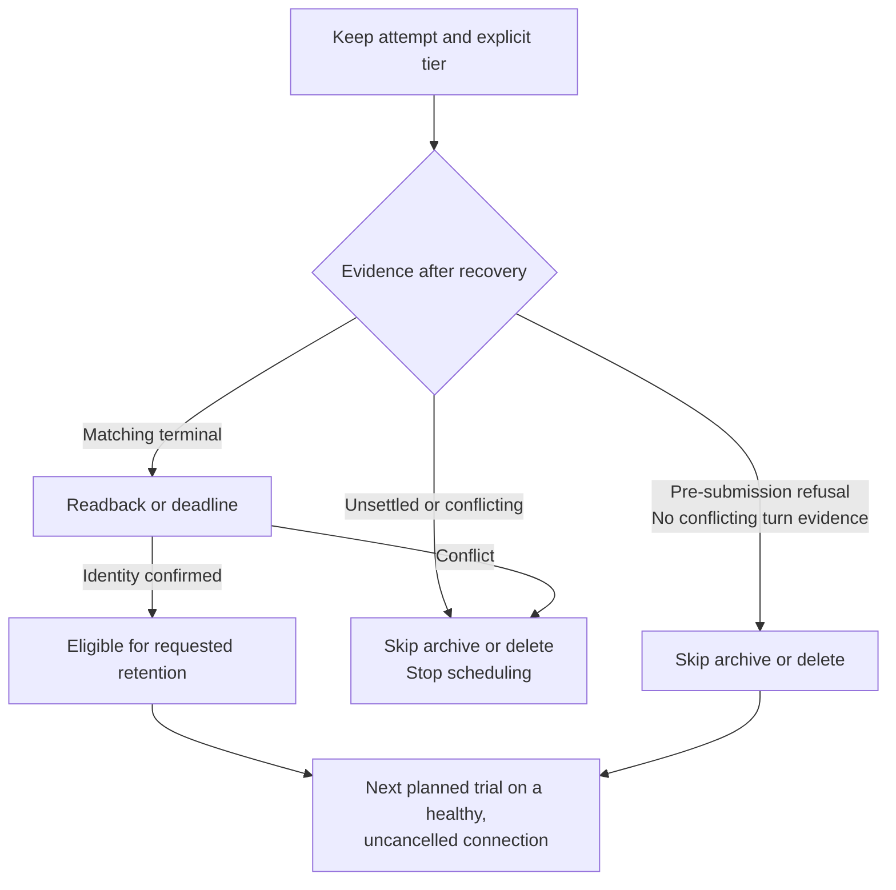

## Implemented caller behavior

Both callers require a fresh, nonempty thread ID and use local stdin acceptance of `turn/start` to record an explicit `sentTier`. The benchmark also records `inferenceAttempted`. A proven local refusal can allow the next planned trial. Continuation requires a healthy connection and an uncancelled run. [^transport] [^usage] [^benchmark] [^live]

After local acceptance, a recognized pre-submission refusal can also permit continuation without archive or delete. Both callers recognize the structured `input_too_large` error when no conflicting turn evidence has been observed. An unsettled start after recovery stops the workload. A matching live terminal event can permit retention after readback or its deadline. A conflicting start during readback prevents retention. If a retention request is already in flight when the conflict arrives, both callers preserve its result and stop scheduling. [^benchmark] [^live] [^retention] [^native-turn-start]

**Decision after local stdin acceptance**

The guide describes report fields and caller-specific deadlines. The implementation record contains the validation evidence. [Benchmark guide](../guides/codex-benchmark.md) · [Implementation record](../plans/jobs/2026-11-20-codex-benchmark-lifecycle-corrections.md)

## Evidence

### Client dispatch

In the refusal probe, the server closed stdin before replying to the measured `thread/start`. The client saw writable stdin before the `turn/start` write in both cases below. Previously, `codex-bench` called `onQueued` when `write()` returned without throwing. Both callers now check for an immediate stream error before the callback. [^transport] [^dispatch]

| Measured `write()` returned `false` | Server trace | Benchmark before correction | Verified benchmark report |
| --- | --- | --- | --- |
| Immediate `EPIPE` | Warm-up only | `inferenceAttempted: true`, `sentTier: "default"`. The 230-token total is marked partial. | `inferenceAttempted: false`, `sentTier: null`. The 230-token total stays complete. |
| Backpressure with bytes buffered and no immediate error | One measured `turn/start` after warm-up | Attempt recorded with `sentTier: "default"` | Attempt recorded with `sentTier: "default"` |

The regression suite also covers a local write refusal on a healthy connection. Both callers skip retention for that thread and can proceed to the next planned trial. Later transport loss preserves the accepted attempt and tier and stops scheduling. The live check reports a null `sentTier` when `thread/start` fails or stdin refuses the `turn/start` write. [^dispatch] [^runner-tests] [^benchmark] [^live]

### Core submission

Native Codex CLI 0.171.0 rejected oversized text on a fresh thread with `-32602` and `data.input_error_code: "input_too_large"`. The rejected thread emitted zero `turn/started` or `turn/completed` through child `close`. A valid request on another fresh thread produced matching lifecycle events. The fixture provider received exactly one request across both cases.

The tagged app-server checks input size before calling Core. Accepted start or steer outcomes return a turn ID, and Core documents that declined input is neither recorded nor enqueued. Source inspection also shows that Core enqueues input before awaiting its internal reply. Losing that reply returns `InternalAgentDied`, which app-server maps to an internal RPC error. Event ordering for other native rejections remains unverified. [^native-turn-start] [^native-core] [^native-reply-loss]

Before the corrections, both callers could schedule another trial after a generic `turn/start` error with no known turn. The synthetic regressions verify that the structured refusal can permit continuation and that a generic error or conflicting turn evidence stops scheduling while completion is unconfirmed. [^benchmark] [^live] [^runner-tests] [^recovery]

### Turn identity and completion

Before the corrections, one synthetic live-check probe reused thread and turn IDs so that one Standard terminal event counted as two completions. The live check sent two archives for the same thread and exited 0 after the fixture acknowledged both. The benchmark rejected the duplicate ID before dispatch. The regression suite now verifies that both callers reject a reused or malformed thread ID before dispatch or retention. [^live] [^benchmark] [^recovery]

Both callers can recover a missing start reply from `turn/started` and a matching `turn/completed` before the start deadline. On an unconfirmed timeout, the benchmark can interrupt a known turn and await its terminal event. The live check stops. A saved `task_complete` can supply timings and helps establish complete usage. The matching live event can authorize retention even when that saved record is absent. [^benchmark] [^live] [^retention] [^recovery]

The regressions exercise a contradictory start notification and a contradictory original RPC reply arriving during readback. They also cover a conflict after archive is sent. When a conflict invalidates the benchmark turn ID, its JSON row clears the timings and throughput, excludes the trial from summaries, and preserves attributable token usage as partial. A known turn ID can still support saved timings on a failed trial. [^recovery] [^record]

### Shutdown

Both callers require child `close` for successful shutdown and require a signal-zero probe to return `ESRCH` for a separately owned POSIX group. In the synthetic live-check regression, group-directed `SIGKILL` reports success with delivery suppressed. The caller exits 1 with both completed Standard/Fast results and a shutdown deadline diagnostic on stderr. Process-table observation at caller exit finds the leader and worker alive before fixture release. This case exercises the child-close deadline. A separate benchmark control covers the group-disappearance deadline. [^shutdown] [^shutdown-tests] [^runner-tests] [^shutdown-record]

The recovery and shutdown suites use a test-owned launcher. The cleanup controls make receipt or observation failures visible through retained scratch and skipped successor suites, and inject uncertainty only after independent confirmation that the synthetic group stopped. The benchmark preloads use ESM in both runtimes and preserve the same dispatch, EOF and signal observations. [^recovery] [^shutdown-tests] [^cleanup] [^record]

The shutdown observations cover synthetic POSIX groups on macOS. Cleanup of escaped descendants, Windows descendant cleanup and fault frequency remain unverified. [^shutdown-tests] [^earlier]

## Related Plans

- [Codex benchmark lifecycle corrections](../plans/plan-2026-11-20-codex-benchmark-lifecycle-corrections.md)
- [Codex turn reporting and app-server shutdown](../plans/plan-2026-11-20-codex-turn-reporting-and-app-server-shutdown.md)
- [Codex CLI benchmark](../plans/plan-2026-11-18-codex-cli-benchmark.md)

## References

[^transport]: [App-server requests](../../src/adapters/codex/app-server.ts) · [Turn write acceptance](../../src/adapters/codex/app-server-write.ts)
[^usage]: [Benchmark token accounting](../../src/cli/codex-bench/usage.ts)
[^dispatch]: [Dispatch accounting cases](../../test/codex-benchmark/dispatch-accounting.app.test.ts) · [Local refusal and backpressure controls](../../test/codex-benchmark/fixtures/turn-write-preload.mjs)
[^runner-tests]: [Benchmark runner cases](../../test/codex-benchmark/benchmark-runner.app.test.ts)
[^live]: [Standard/Fast live check](../../scripts/spikes/codex-benchmark-live-check.ts)
[^benchmark]: [Benchmark runner](../../src/adapters/codex/benchmark/index.ts) · [Turn observer](../../src/adapters/codex/benchmark/turn.ts)
[^retention]: [Shared session retention](../../src/adapters/codex/session-retention.ts) · [Rollout recovery cases](../../test/codex-benchmark/rollout-recovery.app.test.ts)
[^recovery]: [Turn recovery cases](../../test/codex-benchmark/turn-recovery.app.test.ts) · [Recorded caller comparison](../plans/jobs/2026-11-20-codex-turn-reporting-and-app-server-shutdown.md#phase-2-turn-recovery-and-scheduling)
[^native-turn-start]: [Codex 0.171.0 structured input error](https://github.com/openai/codex/blob/rust-v0.171.0/codex-rs/app-server/src/request_processors/turn_processor.rs#L558-L568) · [Size check before submission](https://github.com/openai/codex/blob/rust-v0.171.0/codex-rs/app-server/src/request_processors/turn_processor.rs#L627-L635) · [Submission outcomes](https://github.com/openai/codex/blob/rust-v0.171.0/codex-rs/app-server/src/request_processors/turn_processor.rs#L722-L773) · [Reply containing the turn ID](https://github.com/openai/codex/blob/rust-v0.171.0/codex-rs/app-server/src/request_processors/turn_processor.rs#L789-L804)
[^native-core]: [Codex 0.171.0 Core submission contract](https://github.com/openai/codex/blob/rust-v0.171.0/codex-rs/core/src/codex_thread.rs#L599-L616)
[^native-reply-loss]: [Codex 0.171.0 Core queue and internal reply](https://github.com/openai/codex/blob/rust-v0.171.0/codex-rs/core/src/session/mod.rs#L1237-L1266) · [App-server submission error mapping](https://github.com/openai/codex/blob/rust-v0.171.0/codex-rs/app-server/src/request_processors/turn_processor.rs#L741-L749)
[^shutdown]: [Shared app-server shutdown](../../src/adapters/codex/app-server-shutdown.ts) · [Benchmark CLI exit handling](../../src/cli/commands/codex-bench.ts)
[^shutdown-tests]: [Shared shutdown cases](../../test/codex-benchmark/shared-shutdown.app.test.ts)
[^shutdown-record]: [Live-check shutdown and benchmark exit handling](../plans/jobs/2026-11-20-codex-app-server-version-parsing.md#fourth-follow-up-live-check-worker-shutdown)
[^cleanup]: [Shutdown fixture cleanup tests](../../test/codex-benchmark/shared-shutdown-cleanup.app.test.ts)
[^record]: [Timing follow-up](../plans/jobs/2026-11-20-codex-benchmark-lifecycle-corrections.md#phase-2-follow-up) · [Shutdown fixture cleanup follow-up](../plans/jobs/2026-11-20-codex-benchmark-lifecycle-corrections.md#phase-3-cleanup-follow-up) · [Benchmark preload follow-up](../plans/jobs/2026-11-20-codex-benchmark-lifecycle-corrections.md#benchmark-preload-follow-up)
[^earlier]: [Earlier turn reporting and process shutdown research](research-2026-11-19-codex-turn-reporting-and-process-shutdown.md)
