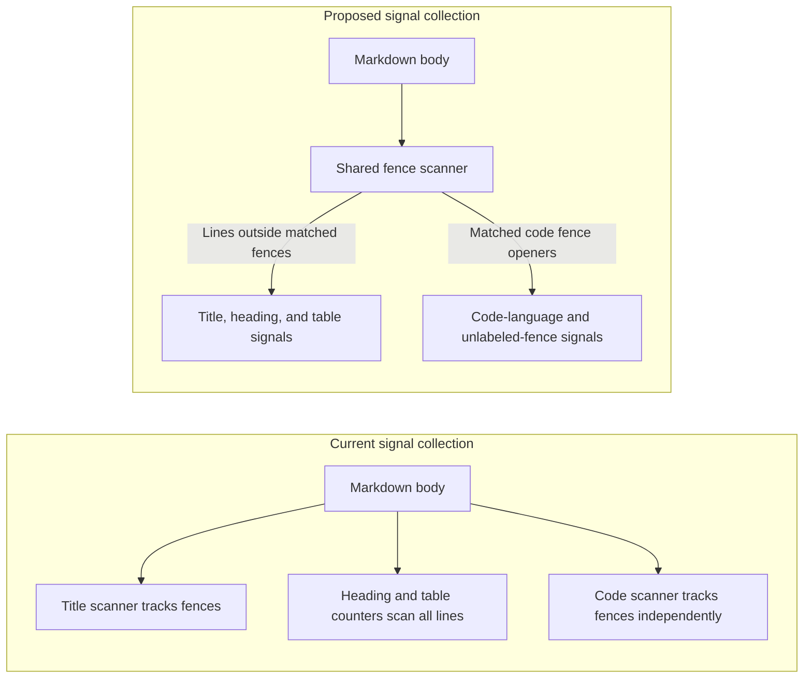

## Scope

This review covers `src/`, `test/`, and `scripts/` at `bfb3e23c`. It records behavior and test gaps, module boundaries that could be easier to maintain, and places where Node or JavaScript built-ins could simplify the code. The security findings are based on source inspection.

## Findings

| Finding | Evidence and direction | Code |
| --- | --- | --- |
| CSV path containment · P2 | Replay checks path strings and misses symlinked parents. Validate the actual parents of both endpoints against the canonical working directory. Path-based preflight requires parents to stay stable through the rename. Decide whether concurrent parent replacement is in scope and, if so, require race-resistant containment during the move. Share a segment-aware lexical check that accepts names such as `..draft`, rejects cross-volume paths, and preserves each caller’s rule for accepting the root itself. | [CSV replay](../../src/cli/rename-plan-csv.ts#L67), [file I/O](../../src/cli/file-io.ts#L24) |
| Markdown PDF remote assets · P2 | The preflight misses stylesheet contents reached through local HTML stylesheet links. Evaluate whether supported WeasyPrint versions can enforce the remote-asset opt-in at the asset-loading boundary. | [Asset preflight](../../src/cli/markdown-pdf/template-assets/remote-policy.ts#L180), [renderer invocation](../../src/cli/markdown-pdf/render.ts#L217) |
| Markdown fence parsing | The title and code scanners can close a fence on a shorter marker. Heading and table counts also include matching lines inside fences. Apply the settled behavior below. | [Title scanner](../../src/cli/markdown-pdf/profile/signals.ts#L180), [code scanner](../../src/cli/markdown-pdf/profile/signals.ts#L263), [signal collection](../../src/cli/markdown-pdf/profile/signals.ts#L348) |
| Codex cancellation coverage | A fixed delay can abort before the child starts, and the fixture records only the last PID. Wait for `config/read` before aborting and verify that every launched child exits. | [Discovery transport tests](../../test/codex-info/transport.app.test.ts#L313) |
| Inline prompts | Path and text prompts duplicate terminal setup, cancellation, and teardown. Share the session lifecycle, keep completion logic in each prompt, and use `Set` for path suggestion deduplication. | [Path prompt](../../src/cli/prompts/path-inline.ts#L242), [text prompt](../../src/cli/prompts/text-inline.ts#L253) |
| Image framing | PNG, WebP, and JPEG use independent streaming parsers in one file. Extract them behind the existing factory and preserve output bytes, chunk handling, and sink backpressure. | [Image framing](../../src/cli/video-frames/image-framing.ts#L49) |
| Markdown PDF test mocks | One installer owns session, authoring, and rendering registrations and counters. Split those registrations by service behind the existing harness entry point. | [Mock installer](../../test/markdown-pdf/interactive/mock-action.ts#L96) |
| Test-runner structure | Launch preflight shares a module with output draining and process-group shutdown. Extract preflight while preserving the distinction between a rejected launch and a spawn failure. | [Process runner](../../scripts/testing/execution/process.ts#L187) |
| CRC-32 built-in | PNG framing and three fixture generators calculate CRC-32 manually. Sample checksums matched `node:zlib.crc32`. Compare generated fixture bytes before replacing the custom implementations. | [PNG profile chunks](../../src/cli/video-frames/profile-chunks.ts#L38), [DOCX fixtures](../../scripts/generate-docx-fixtures.mjs#L69), [data-extract fixtures](../../scripts/generate-data-extract-fixtures.mjs#L164), [data-query fixtures](../../scripts/generate-data-query-fixtures.mjs#L190) |

## Settled Decisions

### Fenced code and document structure

#### Current and proposed signal flow

A checked example with one real heading and a fenced shell snippet containing a `#` comment and a pipe currently produces two headings and one table row. The expected result is one heading, zero table rows, and `sh` as the code language. This keeps code examples from inflating layout suggestions and project report metrics. [Layout signals](../../src/cli/markdown-pdf/template-codex/recipe-signals.ts#L104), [project report](../../src/cli/markdown-pdf/project-codex/report.ts#L109)

Use the shared scanner in both document-level signal collection and direct PDF title detection. Keep the existing heading and table heuristics on lines outside fences. Preserve the signal schema, count limits, and privacy checks. [Document signals](../../src/cli/markdown-pdf/profile/signals.ts#L348), [direct PDF title handling](../../src/cli/actions/markdown/to-pdf-service.ts#L249)

#### Fence rules

Use the renderer’s Pandoc Markdown input mode as the reference for top-level fence recognition. [Pandoc input mode](../../src/cli/markdown-pdf/render.ts#L168)

- An opening fence uses at least three consecutive backticks or tildes. Top-level marker lines allow up to three leading spaces. After a paragraph, a backtick fence may start on the next line. A tilde fence in that position requires a blank line.
- A closing line uses the same marker character and at least as many markers as the opener. Only spaces or tabs may follow the closing run. A shorter marker or a marker followed by a label stays inside the code block.
- A candidate opener with no valid close through the end of input leaves its lines available to ordinary signal collection. Scanning continues so a later valid fence can still be recognized.
- Pandoc raw-format fences such as `{=html}` exclude their bodies from structure signals. Code-language and unlabeled counts apply to fenced code blocks.

#### Verification plan

- Extend the existing Bun signals tests with a valid fence containing a shorter marker, a same-length marker followed by a language label, and heading and table lookalikes. Put the real title and table after the close. Assert the selected title, heading count, table metrics, and code language. [Signals tests](../../test/markdown-pdf/actions/profile-codex/signals.unit.test.ts#L128)
- Add a focused case with an unclosed opener followed by ordinary content and a valid fence. Compare the top-level opener placement, closing indentation, and end-of-input cases with `pandoc --from=markdown --to=native`.
- In the direct-render suite, add a case with `metadataTitle: auto` and a four-backtick opener. Put a three-backtick line before a fenced H1 that matches the frontmatter title. After the valid four-backtick close, put a different H1. Assert that the generated template retains the metadata title block. [Direct-render tests](../../test/markdown-pdf/actions/rendering/profile-rendering.app.test.ts#L364)
- In the template signal suite, add a case with a narrow real table and a fenced table lookalike wide enough to trigger a `strong` signal if counted. With no explicit layout preset, assert that the real table yields a `weak` signal and that the `wide-table` preset is not inferred. [Template signal tests](../../test/markdown-pdf/actions/template-codex/signal-collection.app.test.ts#L195), [table risk thresholds](../../src/cli/markdown-pdf/profile/layout-policy.ts#L23)
- Run the two updated suites with their existing ordinary-content cases to verify both downstream paths.

Phase 1 implemented these rules in the signal layer using top-level block-boundary heuristics. The verification results and exact reviewed range are recorded in the [Phase 1 implementation record](../plans/jobs/2026-11-22-code-quality-review.md#phase-1-markdown-fenced-code-signals).

## Related Plans

- [Code Quality Review Implementation Plan](../plans/plan-2026-11-22-code-quality-review.md)
