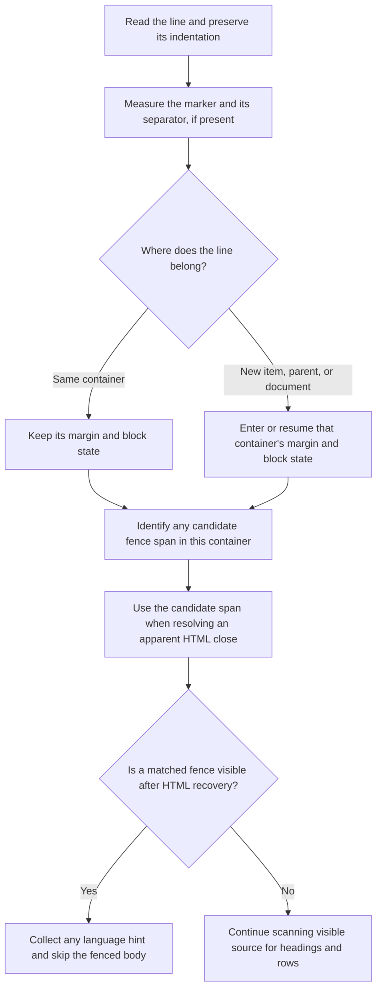
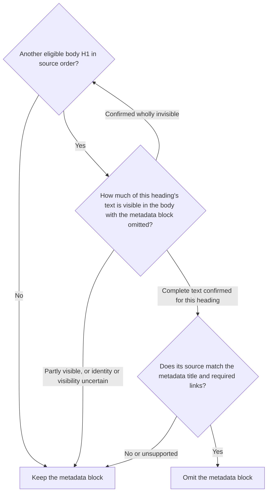

## What prompted this research

During review for the 0.2.2 release, a Python example inside a numbered list exposed a missing language hint in the Markdown PDF authoring helpers. Profile, Template, and Project share a scanner that detects code languages and table-like rows. On the example below, `v0.2.2-canary.7` reported `python` and `v0.2.2-canary.8` dropped that hint. Both versions counted the pipe line inside the example as one source row.

````markdown
1. Item

    ```python
    | fenced | sample |
    ```
````

The four leading spaces matter. Under `1. Item`, the fence starts one column past the start of the item text. Move the same three lines to the top level and those four spaces introduce literal code, including the backticks. Pandoc 3.9 recognizes the Python fence inside the item. Pandoc 2.0, the supported minimum, produces no code block there. Both readers treat the top-level example as literal code.

The installed Pandoc determines how the PDF renders. The authoring helpers also work when Pandoc is absent and need details its parsed document can lose, including the difference between an unlabeled fence and indented literal code, or the width of a source table row. The research question is how the offline scanner can tell which block owns a line before deciding whether a fence opens or closes. [Earlier research on source signals](research-2026-11-22-markdown-pdf-html-boundaries.md#source-scanning)

## Research outcome

The scanner now determines which list item, quote, or document block owns a fence before matching its closer. HTML recovery consults the same span, and the helpers measure visible rows from the original source. For the numbered example above, all three helpers report `python` and exclude the pipe row with Pandoc absent. Rendering preserves each reader’s interpretation. The comparisons below retain the canary and prototype observations that motivated the change. [Implementation plan](../plans/plan-2026-11-24-markdown-pdf-list-block-boundaries.md) · [Verification and review results](../plans/jobs/2026-11-24-markdown-pdf-list-block-boundaries.md#phase-5--validate-documentation-and-close-the-record)

The fence investigation is complete. Comparing the branch with the previous canary also exposed two regressions in the PDF renderer’s automatic title selection. Those findings reopened this research for a separate question. [When can a styled body heading stand in for the metadata title?](#when-can-a-styled-body-heading-stand-in-for-the-metadata-title)

## What successive reviews found

An unpublished prototype measured fence indentation from the start of the list item’s content. That restored the hint in the numbered example. Its first focused review added coverage for paragraph continuations and tab-indented fences and literal code. Subsequent reviews examined the revised scanner, each time varying the marker, the preceding block, or the list level. Reviews 1–8 below describe cases corrected in the prototype. Review 9 found that the prototype still missed a fence after nested verse and reported a false hint under an empty list marker.

| Prototype review | What the scanner got wrong |
| --- | --- |
| 1. Marker spacing | Five spaces after a bullet could turn literal code into a fence or hide a real fence farther down the item. A tab after a bullet or a lettered marker such as `a)` could also hide a nested fence. |
| 2. First content on the item | A comment opener inside literal code could hide a later fence and heading. A fence immediately after a literal line or directly on the list-marker line could lose its hint. Roman markers such as `iv)` and automatic markers such as `#.` could also lose nested hints. |
| 3. Adjacent lines | The scanner missed backtick fences aligned with the item text immediately after prose, tilde fences after a heading on the marker line, and nested fences under empty markers. |
| 4. Prose and pipe tables | A heading-like line that continued a paragraph could admit a false tilde fence and hide a prose row. A real pipe table followed immediately by a fence could lose the hint and gain a spurious row from the code. |
| 5. Other blocks inside an item | Pandoc’s `:::` Div delimiters inside a list could suppress a valid fence. Inline HTML, comments, or a line of dashes continuing a paragraph could instead create a false boundary for the next fence. |
| 6. Sibling item | After a second paragraph in one item, the scanner could treat the next item’s marker as continued prose and miss a fence on that marker line. |
| 7. Return to a parent item | A fence returning to the parent’s margin could inherit the child’s prose, table, or verse context and lose its hint. |
| 8. Compact nesting and verse | Two markers on the same line, as in `- - ~~~python`, could hide the inner fence. A bare pipe marking an empty verse line could also hide the next fence. |
| 9. Return to the document and empty-marker padding | A top-level fence after nested verse lost its hint and its code row was counted. Under an empty marker with no trailing space, literal code gained a false `python` hint. |

The first reviews asked where the item text begins. The later ones showed why a correct column alone is insufficient. A line at the same column can continue a child paragraph, start a sibling, or resume the enclosing document. The comparisons below use a numbered item, a fence after verse, and an empty marker to isolate those differences.

## Paired observations

Each fixture uses a three-backtick or three-tilde opener labeled `python`, the body `| fenced | sample |`, and a matching closer. The indentation shown applies to all three lines, measured from the left edge. Only the ordered-item fixture has a blank line between the preceding text and the opener. Append a blank line, `# Visible heading`, another blank line, and a two-column pipe table with a header, divider, and one data row.

The reader results come from passing each fixture to `pandoc --from=markdown --to=json` on Pandoc 2.0 and 3.9 and inspecting the `CodeBlock` nodes. “Literal” means the node has no language and contains the fence delimiters as text. The two scanner columns report the language hints observed for the same input. The final column gives the proposed hint and the number of source rows that replacing a plain body line with the pipe row should add.

| Preceding text | Fence | Pandoc 2.0 | Pandoc 3.9 | Canary.8 hint | Prototype hint | Proposed hint / added rows |
| --- | --- | --- | --- | --- | --- | --- |
| `1. Item`, then a blank line | Backticks, 4 spaces | No code block | Python in item | None | `python` | `python` / 0 |
| `- - \| poem` | Tildes, 1 space | No code block | Python at top level | `python` | None | `python` / 0 |
| `\| poem` | Tildes, 1 space | No code block | No code block | None | None | None / 1 |
| `- -`, no trailing space | Tildes, 6 spaces | No code block | Python in item | None | `python` | `python` / 0 |
| `- -`, no trailing space | Tildes, 7 spaces | Literal | Literal | None | `python` | None / 1 |
| `- -`, one trailing space | Tildes, 7 spaces | No code block | Python in item | None | `python` | `python` / 0 |

In the seven-space pair, the prototype reports `python` and three source rows both with and without a trailing space after `- -`. Both Pandoc versions read the unpadded case as literal code. For that case, the proposed offline result is no language hint and **four** source rows, counting the pipe-shaped literal line alongside the three lines of the trailing table. With an explicit trailing space, the proposed result is `python` and **three** rows because the fence excludes its body. [Source-row collector](../../src/cli/markdown-pdf/profile/signals.ts)

Two top-level controls establish the indentation rule outside lists. With no preceding text, both readers recognize an unindented backtick fence as Python and a four-space-indented one as literal code. Both scanners report a language only for the unindented fence.

## Why the scanner misses fences and mislabels literal code

The released canary.8 scanner measures indentation from the left edge of the document. It accepts up to three spaces, so it discards the four-space Python opener under `1. Item` before it considers the list. Measuring from the start of the item text lets the prototype recognize that fence. [Fence scanner](../../src/cli/markdown-pdf/profile/fence-signals.ts)

- **A fence after nested verse loses its language hint.** After `- - | poem`, a one-space-indented `~~~python` line has left both list items. Pandoc 3.9 opens a top-level Python block. The prototype tracks the list item separately from the preceding block kind. It leaves the list but still applies the child’s verse-continuation rule, drops `python`, and counts the pipe row inside the fence. Replacing that row with plain text reduces the count from five to four. After top-level verse (`| poem`), the same indentation really does continue the verse.
- **Literal code under an empty marker gains a language hint.** A bare `- -` ends at the final hyphen. The prototype assigns the empty marker at least one column of padding, making its calculated content margin identical to that of `- -` followed by a space. When the seven-space opener reaches the fence check, the scanner can no longer distinguish the two inputs.

## HTML recovery at a list boundary

Canary.8 and the prototype both scan ahead to decide where an HTML comment or a `textarea` ends. The existing recovery fixtures start with an HTML opener, then an H1 and a top-level `sh` fence. Its body contains the apparent HTML close (`-->` or `</textarea>`). The helpers recover the H1 and the `sh` hint because the delimiter is part of the code example. A later `js` fence, H1, and table check where scanning resumes. [Recovery fixtures](../../test/markdown-pdf/actions/fixtures/markdown-source-fixtures.ts)

Move only the three `sh` fence lines under `1. Item`, with a blank line before them and four spaces of indentation on each. Both scanners now lose the earlier H1 and `sh`. The later H1, `js`, and three table rows survive. The prototype recognizes list-relative fences during ordinary scanning, but the earlier HTML recovery pass looks for fences from the left edge. It accepts the delimiter as an HTML close before ordinary scanning reaches the fence. [Fence recovery](../../src/cli/markdown-pdf/profile/fence-signals.ts)

The proposed offline behavior is to recover the same signals in both placements. Pandoc 3.9 omits the earlier H1 and the `sh` block in all four examples. Pandoc 2.0 also omits both for comments. For `textarea`, 2.0 retains the H1 in both placements and recognizes `sh` only at the top level. The reason to recover both signals is consistency with the helpers’ existing top-level behavior.

When a genuine `</textarea>` follows the apparent fence, the text inside the element should stay literal. In the `real-close-after-fenced-textarea-delimiter` fixture, both scanners report only `# Visible heading`, the `js` hint, and three source rows with the apparent `python` fence at the top level. Move the entire fence under `1. Item` and leave the genuine close in place. Both scanners now also expose `# Literal heading` and two pipe rows from inside the element, bringing the count to five. The `js` hint is identical in both placements. [Recovery fixtures](../../test/markdown-pdf/actions/fixtures/markdown-source-fixtures.ts)

## Implementation direction

Resolve the list transition in one place. Keep the marker’s end column and actual separator width, accounting for tab stops. Carry the selected container, its content margin, and its current block kind together into the fence check. A less-indented line can still continue list prose, so deciding its owner may require inspecting whether a candidate opener interrupts that paragraph.



Use the same container-relative span for HTML recovery and for ordinary fence recognition. In the recovery fixtures, the intervening H1 and the later matched fence keep the delimiter inside that fence from closing the earlier HTML opener. If a genuine `</textarea>` follows the apparent fence, that later delimiter closes the element and its contents stay literal. Once HTML and fence boundaries are resolved, one decision supplies the hint and determines which lines reach the heading and table collectors. [Document signal collection](../../src/cli/markdown-pdf/profile/signals.ts)

For the version differences in the table, the offline hint follows the fenced syntax recognized by 3.9. Profile, Template, and Project use the same rule regardless of whether Pandoc is installed.

## Verification criteria

The following comparisons isolate one boundary at a time. The implementation plan used them to verify the scanner and HTML recovery.

| Vary one boundary | What the comparison tests |
| --- | --- |
| Move an opener from a child item to its parent, then to the document. Repeat after verse and after a pipe table. | The destination uses its own block state. A child’s continuation or table rule ends when the child ends. |
| After item prose, compare a less-indented continuation with an adjacent sibling marker. | Indentation alone cannot decide whether the previous paragraph continues. |
| Place the matching closer inside the opener’s item, then move it to a sibling. | A sibling’s closer cannot make the earlier opener consume a later heading or table. |
| Move the `sh` fence under the list item in each HTML recovery fixture. Then insert a genuine HTML close on the line after the opener, before the earlier H1. | For both variants the target is two H1s, `sh` and `js` hints, and three source rows. With the genuine close, the prototype already gives that result. |
| Place the apparent `python` fence at the top level or under `1. Item`, keeping the genuine `</textarea>` after it. | Both placements should expose only `# Visible heading`, the `js` hint, and three table rows. |
| Keep the complete `closed-textarea-with-apparent-fence` fixture as a control. | The apparent `text` fence contributes no hint. Only the later H1 and three table rows are visible to those collectors. |

The checks compare visible headings, language hints, and source-row counts. Replacing a pipe-shaped body line with plain text isolates its contribution. The `sh` recovery fixtures keep the HTML delimiter in the body and assert the totals above. All three helpers ran on the same inputs with zero Pandoc calls. [Offline and reader results](../plans/jobs/2026-11-24-markdown-pdf-list-block-boundaries.md#phase-4--verify-authoring-and-rendering-through-the-application)

## When can a styled body heading stand in for the metadata title?

With the built-in template, the cover off, and a nonempty frontmatter title, `titleBlock.metadataTitle: auto` can omit the metadata block when a body H1 supplies the same title. An author stylesheet can change which heading the reader sees. The current renderer extracts H1 text from a tagged PDF made without the metadata block, then looks for the extracted label among the source headings. [Automatic metadata titles](../guides/markdown-pdf-usage.md#automatic-metadata-titles) · [Current comparison](../../src/cli/markdown-pdf/title/styled-title.ts)

Both examples use the metadata title `Report` and the Markdown heading `# Report {#report}`. With Pandoc 2.0 and 3.9 and WeasyPrint 70.0, the rendered pages differed from the previous canary in opposite ways. [Reproductions and page comparisons](../plans/jobs/2026-11-24-markdown-pdf-list-block-boundaries.md#open-title-findings-after-the-third-canary-review)

| Change to the example | What the reader sees today | Expected result |
| --- | --- | --- |
| Add an earlier H1 with `display:none`. Give `#report` the color `transparent`. | The PDF still yields the text “Report”. `auto` omits the metadata block and the page has no visible title. | Keep the metadata block. The page should match explicit `show`. |
| Make `#report` the first H1 and set `letter-spacing: 0.25em`. | The body heading is visible, but the extracted label reads “R e p o r t”. `auto` also prints the metadata title. | Omit the metadata block. The page should match explicit `hide`. |

### Accepted direction for automatic title selection

The visibility check belongs to the existing `titleBlock.metadataTitle: auto` mode when an author stylesheet applies. Explicit `show` and `hide` honor the author’s choice directly. For `auto`, the implementation target is to omit the metadata block only when the renderer identifies the first visible eligible body H1, its source title and required links match, and its complete text is visible in the layout with the metadata block omitted. If identity or complete visibility is uncertain, keep the block, even if that prints a duplicate. The diagram follows eligible Markdown H1s in source order.



Only a confirmed wholly invisible heading allows the comparison to advance. An earlier visible heading with a different title ends the comparison, even when a later heading matches.

Two controls distinguish these decisions. With `# Re*port* {#report}` and `#report em { visibility: hidden }`, only “Re” is visible, so `auto` should keep the complete metadata title. With `# Report` as the first body heading and `.document-body > h1:first-child { display: none }`, omitting the preceding metadata block hides the H1. Here too, `auto` should keep the block.

### Why a pixel change in every letter is insufficient

The experiment printed the same page twice, suppressing only the selected heading’s text paint on the second pass. Changing pixels revealed the letter-spaced title and correctly excluded the transparent one. Comparing the drawn characters with the source also detected the missing “port” in the emphasis control.

A heading styled with `#report { overflow: hidden; height: .65em }` exposed a limit. The PDF contained all six characters in “Report”, and every glyph’s bounding box contained changed pixels. The page showed only the tops of the letters. An opaque overlay across the lower half of the heading produced the same false result on both readers. This rules out using a pixel change per glyph as the test for complete visibility. [Experiment and timings](../plans/jobs/2026-11-24-markdown-pdf-list-block-boundaries.md#follow-up-experiment-on-complete-title-visibility)

### Experiment on unobscured title text

Can the renderer recognize an ordinary styled title in full and keep the metadata block when that same title is partly obscured? The experiment compared complete letter shapes with the printed page, accounting for clipping and later paint. It used a plain white background.

Use the same metadata title `Report`, first body H1 `# Report {#report}`, and `letter-spacing: .25em` in all four variants. Each expected page comes from rendering that variant with the specified explicit mode.

| Variant | Expected `auto` page | What the comparison establishes |
| --- | --- | --- |
| Whole heading visible | `hide` | Letter spacing preserves the identity of the visible title. |
| Clip the heading to `.65em` high with `overflow: hidden` | `show` | Cutting through the letters makes the title incomplete. |
| Paint an opaque rectangle over the lower half of the letters | `show` | Later paint can obscure glyphs that fit inside the heading. |
| Move that same rectangle into blank space on the page | `hide` | The rectangle matters only when it obscures the title. |

On both readers the original transparent-heading case must match `show`, as must hidden emphasis and the `:first-child` selector. The visible navy heading must match `hide`. Use the fully visible letter-spaced fixture for two independent fallback checks. First withhold the evidence linking the printed text to its source H1. Then identify the H1 but withhold the evidence that its text is unobscured. Each decision must keep the metadata block and produce the `show` page.

All four variants matched their expected pages on Pandoc 2.0 and 3.9. A second clipping control left enough room for the complete title and matched `hide` on both. The prototype also retained the block when identity or visibility evidence was withheld. The explicit controls were distinguishable in every case and served only to check the decision. [Results and proof cost](../plans/jobs/2026-11-24-markdown-pdf-list-block-boundaries.md#unobscured-title-experiment)

### Identifying a plain-text H1 in Node.js

Two headings with the same text can share a PDF destination position. For a single plain-text H1, the Node.js prototype printed the page with the metadata block omitted, then reversed only that heading’s text and printed it again. The same tagged run had to change from “Report” to “tropeR” while the surrounding drawing instructions and destinations stayed stable. CSS-generated “Report” therefore kept the block. A reversal that leaves the text unchanged, as with “LEVEL”, cannot establish identity either.

Use the original proof to judge visibility. For the letter-spaced “Report”, all six opaque glyph outlines fit inside the page and its active clips on a white background. A clip through the letters or later paint covering them kept the metadata block. On Pandoc 2.0 and 3.9 with WeasyPrint 69.0, the second proof and inspection added about 0.26–0.27 seconds on this one-page example. This supports implementing the single-run case. Preserving title selection when an earlier H1 is hidden and a later one matches remains a compatibility check. [Node.js results](../plans/jobs/2026-11-24-markdown-pdf-list-block-boundaries.md#nodejs-title-visibility-experiment) · [Follow-up phase](../plans/plan-2026-11-24-markdown-pdf-list-block-boundaries.md#follow-up--automatic-metadata-titles-under-author-css)

### Preserving the first matching H1

The built-in `md to-pdf` title policy shipped in `v0.1.5` at `6cd30daa`. A visible first H1 that matches the frontmatter title should supply the single printed title in `auto`, including when emphasis splits its text. The same rule applies after a wholly hidden earlier H1.

The bounded extension changed the source text separately in each inline fragment and required each printed run to show its corresponding change. It checked every glyph outline in the original proof. For italic text, adjacent glyphs can have overlapping bounding boxes even when their outlines are separate. Comparing the outlines preserved the complete formatted heading on both readers. [Two-reader results](../plans/jobs/2026-11-24-markdown-pdf-list-block-boundaries.md#earlier-hidden-heading-compatibility)

### Where should metadata-title selection live?

Both parts of `auto` now live under `src/cli/markdown-pdf/title/`. [Module layout and verification](../plans/jobs/2026-11-24-markdown-pdf-list-block-boundaries.md#title-selection-module-layout)

| Responsibility | Files |
| --- | --- |
| Match source headings and interpret inline styles | `ast-title.ts`, `ast-title-visibility.ts`, `ast-title-variables.ts` |
| Inspect printed headings and select the metadata title block | `styled-title.ts` |

- `pandoc-source.ts` supplies the parsed Markdown.
- `render.ts` coordinates printing.

## Related Plans

- [Markdown PDF list block boundaries implementation](../plans/plan-2026-11-24-markdown-pdf-list-block-boundaries.md)
- [Markdown PDF AST rendering implementation](../plans/plan-2026-11-22-markdown-pdf-ast-rendering.md)
